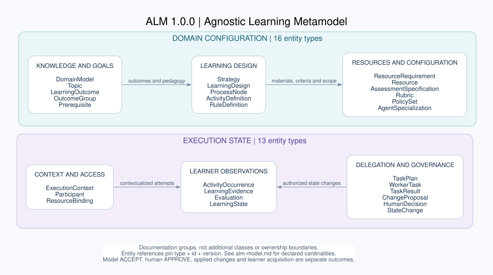
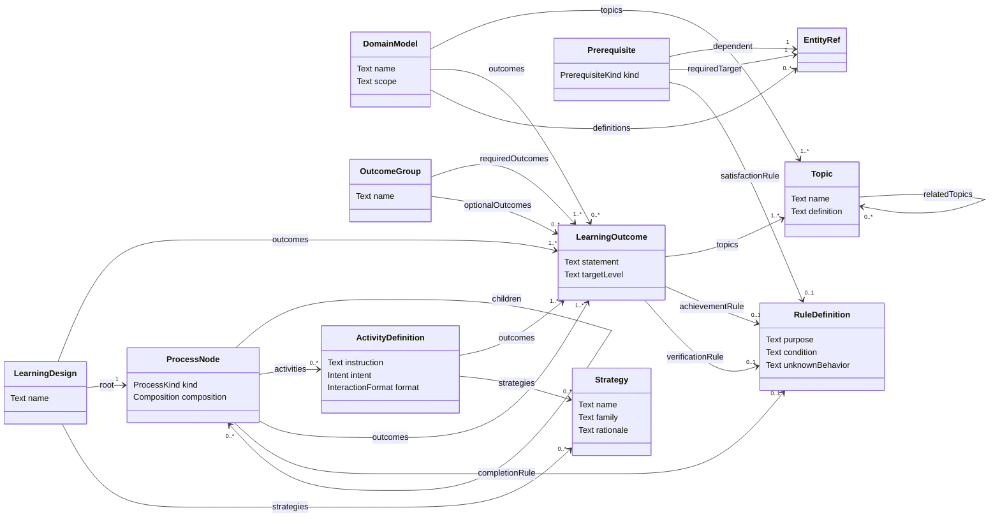
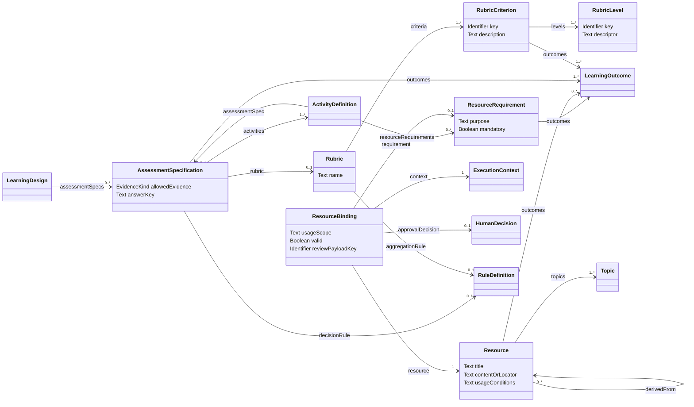
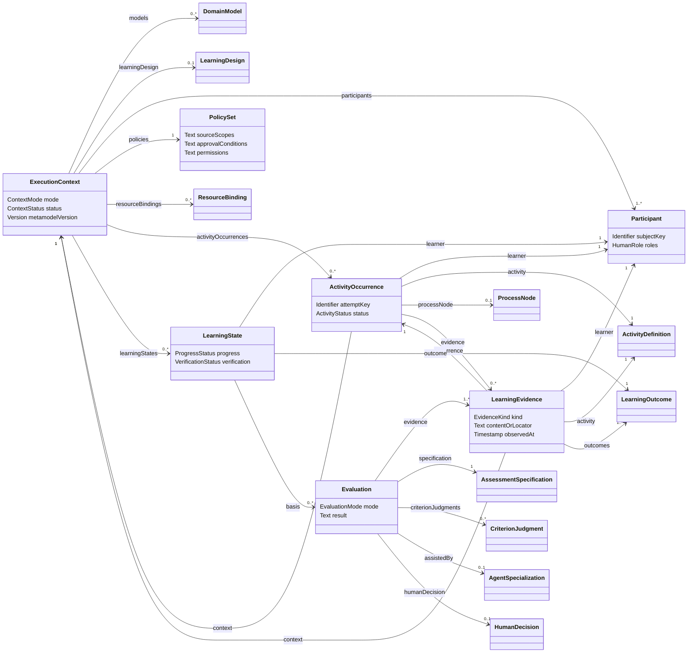
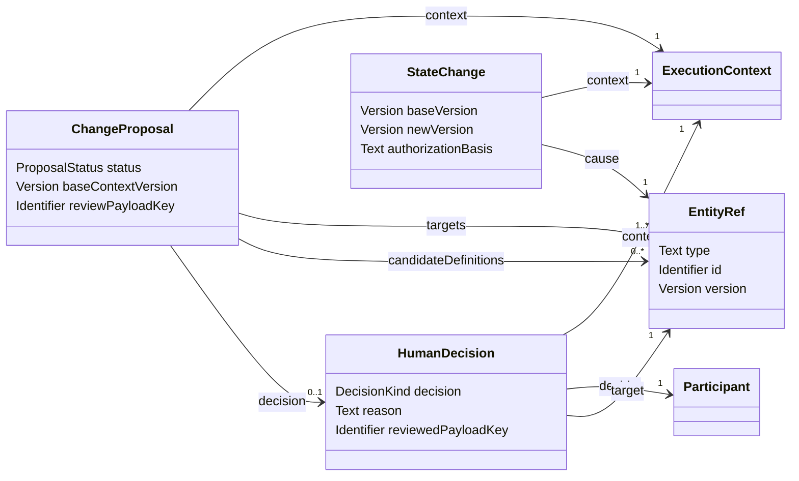
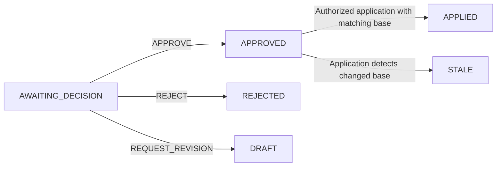
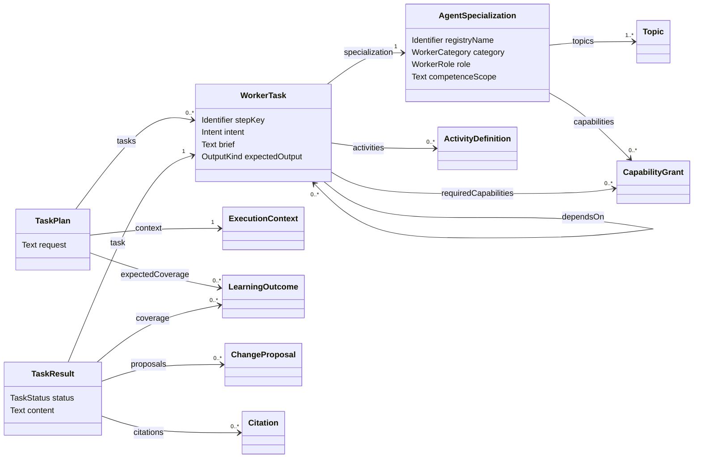

# ALM conceptual model

ALM means **Agnostic Learning Metamodel**. Its normative artifact is the
[ALM 1.0.0 JSON contract](../resources/metamodello-agnostico-apprendimento.json),
whose title is “Agnostic metamodel for the multi-agent learning system”. It
describes learning independently of subject, institution and platform.

This document presents the existing contract, without changing its types or
rules. It contains **29 entity types**: 16 domain-configuration types and 13
execution-state types, plus eight value types. The diagrams are documentation
views, not additional classes, database tables or jjodel exports.

The overview is also available as a [standalone SVG](alm-model.svg), with
[editable Graphviz source](alm-model.dot). The five UML views below show selected
declared relationships; the JSON remains the complete field/constraint reference.
An [Ecore rendering](alm.ecore) of the same contract, with rules R01–R21 as
annotations, is provided for EMF-based tools; it is a view, not a second normative source.

## Identity and diagram notation

Every entity has a `type`, stable `id`, exact `version`, `provenance`, and its
type-specific fields. The common `id`, `version` and `provenance` fields are
mandatory. References use `EntityRef(type, id, version)`; no reference implicitly
means the latest version.

An arrow names the source field. Its target multiplicity describes the number
of target values **for one source record**: `1`, `0..1`, `0..*` or `1..*`.
Inverse multiplicities are omitted because the JSON does not declare them.
An entity-valued field stores exact EntityRefs; a value-type field embeds records.
Arrows show these field relationships without asserting exclusive ownership or
UML composition. Attribute blocks show element types; their optionality and list
multiplicities remain defined in the JSON. Diagrams omit some attributes and
context links to remain readable.

`EntityRef` is a value type. Fields such as proposal targets or change causes can
refer to different entity types; the document does not replace them with an
invented concrete target class.

## 1. Domain knowledge and learning design

A Topic describes a subject; a LearningOutcome describes an expected observable
result. A DomainModel groups versioned definitions without extending ALM's
classes. A Strategy is a pedagogical method, not an agent role.

LearningDesign is optional for isolated interactions. When present, its root is
a PHASE. PHASE nodes contain child nodes, with explicit SEQUENTIAL or INDEPENDENT
composition; UNIT nodes contain activities. Empty draft units can exist but are
not ready for use. Pedagogical Prerequisites are distinct from dependencies
between worker tasks or application authoring artifacts.

## 2. Resources and assessment configuration

ResourceRequirement describes a need. Resource describes candidate or existing
content and its provenance. ResourceBinding selects an exact resource for a
particular context and usage scope. A retrieved resource, licence assertion or
`valid=true` flag alone does not establish an approved binding or learner access.

AssessmentSpecification fixes activities, permitted evidence and any rubric or
decision rule. RubricCriterion and RubricLevel are nested **value types**. Scores,
weights and aggregation are optional; their presence must follow explicit
configuration. A rubric alone does not imply a passing threshold or acquisition.

## 3. Context, attempts, evidence and learner state

Participants are humans with contextual roles; AgentSpecialization describes
workers. PolicySet is a versioned domain definition referenced by a context.
The implementation also checks the trusted policy configuration; policy prose
is never executed as authorization code.

ActivityDefinition is reusable. ActivityOccurrence records a particular use or
attempt. LearningEvidence records an actual learner observation/production, and
Evaluation judges that evidence against the fixed specification. LearningState
separates progress from verification for a person and outcome.

| Independent state dimension | Declared values |
| --- | --- |
| Context mode | PREPARATION, LEARNING |
| Context status | DRAFT, ACTIVE, PAUSED, CLOSED |
| Activity status | NOT_STARTED, IN_PROGRESS, COMPLETED, SKIPPED |
| Outcome progress | NOT_OBSERVED, IN_PROGRESS, ACQUIRED |
| Verification | UNVERIFIED, PENDING_CONFIRMATION, VERIFIED |
| Evaluation mode | FORMATIVE, FORMAL |

These vocabularies do not establish automatic transitions. In the current
implementation, submission records an IN_PROGRESS occurrence. Applying an
evaluation requires consistent evidence and an authorized decision; acquisition
and verification additionally depend on explicit rules and approvals. A completed
activity is not, by itself, an acquired or formally verified outcome.

## 4. Proposals, human decisions and applied changes

The proposal describes a candidate change; a responsible human reviews an exact
payload; application control records the applied change and new context version.
APPROVE is separate from application. StateChange.cause is polymorphic: a human
reviewed proposal is one cause, while recording observed learner evidence is
another. Every StateChange is not necessarily an approval event.

The following is a **current proposal-service example**, not a complete transition
specification for every entity in the metamodel:

Model review ACCEPT, human APPROVE, successful worker execution and APPLIED
proposal status have different meanings. Learner-only permissions do not become
`propose` authority because an Evaluator worker returned a candidate change.

## 5. Agent specialization and delegation

The contract has four worker categories: TEACHER_TRAINER, CURATOR, EVALUATOR and
SOCRATIC, with five roles: TEACHER, TRAINER, CURATOR, EVALUATOR and SOCRATIC. The
Lead plans/reviews through the application architecture; it is not an extra
WorkerRole value. AgentSpecialization describes admissibility and scope, not a
system prompt or executable implementation.

A WorkerTask is an agent assignment; ActivityDefinition and ActivityOccurrence
describe the learner's work. TaskResult statuses PENDING, SUCCEEDED, FAILED and
SKIPPED do not determine learner completion or competence. A successful Teacher
explanation can leave learner evidence and activity occurrences entirely empty.

## Complete entity inventory

| Domain configuration — 16 types | Meaning |
| --- | --- |
| DomainModel | Versioned catalogue of a subject's definitions |
| Topic | Subject or concept |
| LearningOutcome | Expected observable result |
| OutcomeGroup | Required and optional outcomes |
| Prerequisite | Explicit pedagogical requirement or recommendation |
| Strategy | Pedagogical method |
| LearningDesign | Reusable learning path |
| ProcessNode | PHASE or UNIT in the path |
| ActivityDefinition | Reusable learner action |
| ResourceRequirement | Need for learning material |
| Resource | Source or learning material |
| AssessmentSpecification | Fixed assessment/evidence blueprint |
| Rubric | Criteria and described levels |
| RuleDefinition | Declarative satisfaction/completion/decision criterion |
| PolicySet | Versioned policy description |
| AgentSpecialization | Worker role, scope and admissibility |

| Execution state — 13 types | Meaning |
| --- | --- |
| ExecutionContext | Independent session or delivery |
| Participant | Human with contextual roles |
| ResourceBinding | Context-specific resource selection and approval link |
| LearningState | Person/outcome progress and verification |
| LearningEvidence | Observed learner production |
| Evaluation | Judgment against fixed criteria and evidence |
| ChangeProposal | Reviewable candidate change |
| HumanDecision | Authorized person's decision on an exact payload |
| TaskPlan | Lead's delegation plan |
| WorkerTask | Assignment to one specialization |
| TaskResult | Delegation outcome |
| StateChange | Recorded authoritative change and cause |
| ActivityOccurrence | Actual learner use or attempt |

## Value types

| Value type | Purpose |
| --- | --- |
| EntityRef | Exact entity type, identity and version |
| Provenance | Origin, sources, responsible party and optional rationale |
| CapabilityGrant | Capability, access path, operations, scope and purpose |
| RubricCriterion | Criterion key, outcomes, description and levels; optional weight |
| RubricLevel | Level key and descriptor; optional score |
| CriterionJudgment | Criterion/level keys, relevant evidence and reason |
| Finding | Code, target, severity, reason and resolution |
| Citation | Exact Resource reference, optional locator and supported claim |

Value types are embedded records rather than independently identified entities.
RuleDefinition text is declarative; the runtime binds explicitly configured
handlers rather than executing source conditions as code.

## Relationship to AIM-PRO and the authoring architecture

The externally owned AIM-PRO/jjodel project remains an immutable source. The local
adapter preserves its identities, values and diagnostics and maps reviewed input
into ALM definitions. [The execution trace](../aimpro/execution-trace.md) links ALM
records back to exact AIM-PRO source objects; that association does not make them
the same metamodel classes or an importable jjodel graph.

The [versioned authoring architecture](authoring-lifecycle.md) introduces local
application records such as ProjectManifest and ReleaseManifest, persisted as
existing Resources. They are not additional ALM entity types. The
[production project service](authoring-projects.md) persists project selections
through those existing entities. Release/import operations remain
reference-only; neither this service nor its acceptance cycle changes the
normative model or completes the dedicated #9/#10 generators.
