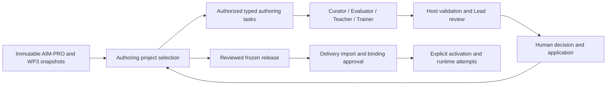

# Versioned authoring projects and frozen learning releases

Status: production authoring-project and dedicated-generator services/CLI with executable acceptance.
Release/import operations remain reference-only. The repository owner requested
this design and a complete cycle using simulated agents before implementing the
dedicated generators in #9 and #10. Those generators are now implemented locally
and tested with synthetic model responses; their live generation/review evidence
remains pending for Teacher/Trainer. See [the generator guide](authoring-generators.md),
the [approved SCN01 Evaluator evidence](../aimpro/scn01-evaluator-example.md) and the
[six-topic decision register](agentic-network-decisions.md).

For the existing entity model, its cardinalities and the distinction between
configuration and execution state, see [the ALM conceptual model](alm-model.md).

The reference contracts are in [`learning/authoring.py`](../../learning/authoring.py).
The acceptance scenarios are in
[`tests/test_authoring_cycle.py`](../../tests/test_authoring_cycle.py). Production
project operations are implemented in `learning/projects.py`; see
[the authoring-project CLI guide](authoring-projects.md). Release/import commands
described below remain the target application interface.

## Problem and decision

SCN01 already has an immutable-source adapter, delegated Curator syllabus
generation, a proposal/decision/application lifecycle, and a separate working
Teacher/Trainer learner demo. The next step is to compose authoring artifacts
without losing their approval identity or changing historical learner attempts.

Today `approved_aimpro_syllabus` deliberately accepts only the current exact
LearningDesign and the matching syllabus outline. Adding an assessment or teaching
activity creates a new composite design. Reusing that current-design resolver as
the only authoring handoff would therefore reject a still-approved syllabus.

The application maintains an explicit project selection of independently
versioned artifacts. Each artifact records exact generation dependencies. A
reviewed release freezes one compatible selection and its domain definitions.
Delivery contexts import a specific release and own their learner state and
resource-use approvals. Authoring continues in its own PREPARATION/DRAFT context.



This uses the existing ALM state authority. Application manifests are stored in
existing Resource entities and indexed through DomainModels. No AIM-PRO/jjodel
type, supplied export, ALM metamodel declaration or database schema is changed.
Issues #1–#4 keep their original scope; this design does not resolve them.

## Boundaries and identity

| Concept | Identity and responsibility |
| --- | --- |
| Source snapshot | Exact source hash, metamodel fingerprint, original values/diagnostics and retrieved resource/version/segments. Never overwritten by a local design revision. |
| Authoring project | Stable application `project_id`, with immutable Resource revisions describing the selected artifact graph and composite LearningDesign. |
| Artifact | Stable Resource id and exact version; SOURCE, SYLLABUS, ASSESSMENT, TEACHER_CONTENT or TRAINER_CONTENT. Associated domain definitions are pinned separately. |
| Proposal | Existing ChangeProposal, based on an exact context revision. Candidate content has its existing review payload key. |
| Approval | Existing HumanDecision plus applied StateChange. A model's ACCEPT is a separate quality judgment. |
| Release | An immutable Resource containing a ReleaseManifest, with its own reviewed/applied proposal. It pins a project revision, domain, design and artifact versions. |
| Delivery | A separate ExecutionContext referencing the frozen domain. Its bindings, policy, participants, attempts and evaluations belong to that context. |

`ArtifactSelection`, `ProjectManifest`, `ReleaseManifest` and `ReviewReceipt` are
local typed application records, not new metamodel entities. Manifests do not
contain an authoritative `approved: true` flag. The application derives approval
from exact stored candidates and the existing decision/application records under
current reviewer authority.

Only one version of each artifact identity is selected in a project revision.
`latest` references and duplicate selection identities are invalid. Artifact
keys are stable within the project; jjodel object ids retain their source meaning.
Neither a local project id nor an artifact key replaces a source object id.

## Commands and role contracts

Every authoring command needs a request id, subject, owning context,
base context/project revision, exact input artifact refs and requested output
slots. Application control authorizes access before retrieval or constructing
model clients. It reserves the request and records the input snapshot. Inputs,
source schemas, retrieved text and worker results remain untrusted data.

| Transformation | Exact input | Proposed output |
| --- | --- | --- |
| Curator | Scenario/competency closure, authorized excerpts, explicit local brief | SyllabusDraft with ordered units, purposes, intents, citations and gaps; implemented in #8. |
| Evaluator authoring | Approved syllabus units/outcomes and authorized sources | Typed ASSESS items, criterion-specific rubric levels and evidence requirements; real SCN01 generation, owner approval and isolated application documented in #9. |
| Teacher authoring | Approved syllabus, exact relevant approved assessments, source/material constraints | Complete explanations, examples and transcripts tied to planned EXPLAIN units; local implementation, #10 live evidence pending. |
| Trainer authoring | The same approved syllabus, exact relevant approved assessments and optional approved shared Teacher assets | Complete practice instructions and worksheets tied to planned PRACTICE units; local implementation, #10 live evidence pending. |
| Runtime roles | Frozen definitions, context-authorized exact resources and actual learner evidence | Checked explanation, feedback or a proposed evaluation. No direct approval, activation or acquisition authority. |

Application control allocates activity/asset identities and validates references.
The Evaluator may generate its own assessment items before Teacher/Trainer content
exists. This avoids referring to nonexistent future instructional activity ids.
The acceptance fixture uses a distinct ASSESS activity for a formative assessment;
the PRACTICE submission and assessment submission are separate observed events.

The Lead can propose work within the authorized capability catalogue and review
results. Deterministic code controls dispatch, validation, review eligibility,
candidate persistence and state transitions. Production #9/#10 adapters use
registered typed authoring contracts. Learner WorkerOutput and R16 remain intact.

Agent output is not allowed to select its own permissions, invent reviewed
receipts, change dependency refs supplied by control, or write SQLite directly.
The coordinator records dependencies from the actual task inputs. A claimed
dependency list in generated prose is not evidence of a generation dependency.

## Lifecycle and concurrency

Authoring job execution and artifact review are distinct lifecycles:

```text
Authorized request -> reserved job -> typed output -> host checks -> Lead review
                                                           |
                                               pending ChangeProposal
                                                           |
                               APPROVE / REJECT / REQUEST_REVISION
                                                           |
                                       separate authorized application
```

REJECT or UNCERTAIN from the Lead produces no accepted candidate proposal.
Human APPROVE does not itself apply the proposal. A complete accepted result is
saved with the terminal request outcome atomically. Reusing an identical completed
request returns that outcome; changing inputs under the id conflicts.

Application must compare both the proposal's base context version and the pinned
dependency revisions. An unrelated context edit can make a pending proposal
stale even when its content remains useful; recovery is an explicit rebased
proposal with fresh review, not silent replay of its old authorization.

The read-only reference helpers do not implement job reservation or write
commands. The production project service holds a SQLite write transaction through
input resolution, request reservation and atomic proposal/result persistence;
inspection and syllabus resolution each use one read transaction. Application
rechecks project and artifact approval/dependency conditions under its final write
lock, in addition to the existing context compare-and-swap. The dedicated
generators use two short write transactions, recording their complete input
snapshot before external work and rechecking it before atomic proposal/result
persistence. They hold no SQLite write lock during model construction or calls.

## Dependency freshness and focused revision

Dependencies are directed edges between exact artifact Resource versions.
`dependency_findings` compares those edges with the selected versions, rejects
missing dependencies and cycles, and propagates staleness to dependants.

Example:

```text
source@1 -> syllabus@1 -> assessment@1
                         |         |
                         +-> teacher-content@1
                         +-> trainer-content@1
```

When assessment@2 replaces assessment@1 in the current project, content that
consumed assessment@1 requires revision. The unchanged source and syllabus remain
eligible with their existing exact approvals. Regenerating/reviewing only those
dependants produces content@2 and a new compatible project selection.

This does not revoke historical approvals or rewrite assessment@1. A prior release
continues to reference its original compatible graph. Freshness is relative to a
project selection, not a global rule that every reference must point to the most
recent object ever stored. Fields such as a display title can be treated more
selectively only after a documented semantic dependency policy exists; the first
slice conservatively tracks whole artifact versions.

The reference `review_receipt` proves the syllabus artifact's original approved
payload independently of the evolving composite design. The existing
`show-aimpro-syllabus` current-outline behavior is unchanged. Production
`show-project-syllabus` uses the explicit project selection/receipt boundary;
the older CLI keeps its current-exact-outline meaning.

## Release, delivery and history

Release preparation requires the current project's own approval/application,
every required artifact, consistent exact dependencies, valid artifact receipts,
and a structurally consistent domain containing the selected definitions. The
domain must be an exact candidate reviewed/applied with that project revision;
an unrelated domain containing similar refs is not an interchangeable release.
`prepare_release` produces a manifest for a new proposal. It does not publish,
approve or activate anything. Semantic completeness and source support still
require model and human review; typed refs alone cannot establish them.

The host then proposes the ReleaseManifest as an existing Resource. After its
explicit human decision/application, `released_entities` reads the frozen domain
closure. It verifies the pinned project/artifacts and their receipts and rejects
authoring execution-state entities in that closure. Reads need a single SQLite
transaction. The selection is independent of subsequent authoring revisions.

Import into a delivery context is another reviewed operation. It pins the frozen
domain/design and proposes any destination-specific workers, policies and resource
bindings. Authoring approval does not confer permission to use a resource with a
new learner/audience. Activation is a separate proposal after existing readiness
checks pass. Completion handlers must be explicitly configured and bound.

For the first slice, an active delivery remains on its imported release. A new
release supports a new delivery; upgrading an existing one needs a separately
specified reviewed migration. There is no automatic switch to the latest release.

Submission uses the current delivery's exact ActivityDefinition version and
records observed evidence with an IN_PROGRESS occurrence. Evaluation uses the
assessment specification/rubric fixed for that activity. A new rubric in authoring
cannot reinterpret an old submission. Trainer task success does not complete the
learner activity. Applying a formative evaluation without acquisition/verification
rules preserves IN_PROGRESS/UNVERIFIED learning state.

The existing LearningService checks `propose` permission against the requesting
subject when persisting worker proposals. A learner-only request therefore cannot
save an Evaluator's change proposal. The reference cycle keeps that restriction
and routes proposed evaluation through an explicitly authorized assessor using
the existing generic proposal service. A production assessor-facing evaluation
adapter remains necessary. Broadening learner permissions to make this test pass
would violate the boundary rather than complete the workflow.

## Executable acceptance and its limits

Run without credentials, `.env`, Docker, MCP or network access:

```bash
.venv/bin/python -m unittest tests.test_authoring_cycle -v
```

The fixture uses temporary SQLite databases and explicit synthetic identities.
It does not touch the existing SCN01 demo or approve the real pending syllabus.

| Real production mechanism exercised | Simulated boundary |
| --- | --- |
| AIM-PRO source preparation, typed Curator checks and candidate mapping | Curator output, Lead verdict and corpus search response |
| Production project initialization/revisions, stable syllabus resolution, dedicated #9/#10 services, registry dispatch, candidate mapping, dependency contracts and receipts | Model responses; release/import command adapters |
| LearningService proposals, exact human-review payloads, decisions and application | Test operator explicitly records synthetic decisions |
| CrewAI Flow, registry authorization, TaskDispatcher, output guards and SQLite request results | Lead plans/reviews/synthesis and Teacher/Trainer outputs; an Evaluator worker is also simulated for the learner-permission rejection case |
| Evaluation validation and reviewed application under actual assessor permissions | Future assessor-facing adapter generates the typed formative Evaluation candidate |
| Readiness, binding approval, explicit activation, observed attempts and evaluation validation | Lexical retrieval response containing a synthetic exact-version resource |
| Historical domain refs and read-only ALM execution-trace export | No external provider or external persistence service |

The acceptance covers:

1. Source-backed syllabus → explicit review/application → assessment and complete
   Teacher/Trainer content proposals → evolving project selection.
2. Refusal to release pending or incomplete projects and refusal to import an
   unapproved release; separate release review, delivery import and activation.
3. Real runtime delegation to simulated Teacher/Trainer outputs, exact scoped retrieval,
   explanation replay, observed practice/assessment submissions, feedback, pending
   assessor-requested evaluation and explicit evaluation review/application.
4. No inferred acquisition, verification or activity completion, and no model
   construction on an identical replay.
5. Assessment revision → transitive content staleness → release refusal → focused
   rebuild → second release, with the original delivery and evidence unchanged.
6. Valid evaluation against the historical specification and rejection of using a
   newly authored specification to reinterpret that evidence.
7. Rejection of an Evaluator proposal produced under learner-only permissions,
   without granting that learner broader state-change authority.

This exercises production project and generator operations with synthetic model
responses and an executable architecture specification for subsequent stages.
It does not establish a source-backed #9/#10 live run, a production release CLI,
a semantic-quality benchmark or a complete observed activity-completion workflow.
The existing ALM engine performs authoritative state transitions; release/import
commands and an assessor-facing evaluation adapter remain to be implemented.
Explicit synthetic completion rules are configured during the reference delivery
import, separately from generation. No issue closure follows merely from tests.

## Implementation sequence after architecture review

1. Review these contracts, boundaries and acceptance assertions with the owner.
2. Delivered locally: production project persistence/commands and stable
   approved-syllabus resolution, with request replay, transaction boundaries,
   review receipts and application-time revalidation. See the CLI guide and
   `tests/test_authoring_projects.py`; publication is a separate authorized step.
3. Implemented locally: dedicated Evaluator (#9), then Teacher/Trainer (#10)
   adapters replace generator fixtures while retaining synthetic model responses.
   Complete a newly authorized real generation/review run before closing them.
4. Add production release/import commands and a guided review surface using the
   same services, then exercise one explicitly authorized source-backed real run.
5. Extend #25 with adversarial/relevance/completeness cases and measured latency.
   Broader digital twins, orchestration comparisons and runtime migrations retain
   their independent decisions and acceptance criteria.
