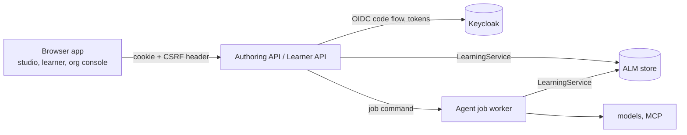

# Role applications: processes, modules and identity

This guide fixes the backend boundaries of the role applications described in the
[role-applications plan](../plans/role-applications-plan.md) and ordered by the
[prototype roadmap](../plans/prototype-roadmap.md). It applies owner defaults
D8–D10, approved with the roadmap (PR #73) and confirmed on 9 November 2026.

S03 builds the shared skeleton: `services/api_common` and an Authoring API
with health and identity routes. S05 adds the first read-only modules (see
[Read-only authoring endpoints](#read-only-authoring-endpoints-s05)); S06 adds
decisions and application (see [Review endpoints](#review-endpoints-s06)). S04 adds the front-end workspace in `apps/` and a studio
shell that signs in through the API (see [Front-end workspace](#front-end-workspace)); S07 adds the
studio review inbox, milestone M1 (see [Studio review inbox](#studio-review-inbox-s07)), and S07b a
read-only course overview (see [Studio course overview](#studio-course-overview-s07b)). S08 adds the agent job worker, its
jobs store and the `jobs` module (see [Agent jobs](#agent-jobs)). ALM remains the reference model. Nothing here changes
the ALM metamodel, the store schema or an AIM-PRO/jjodel export.

## Processes



| Process | Owns | Not allowed |
| --- | --- | --- |
| Authoring API (`services/authoring_api`) | staff sessions; projects, proposals, decisions, sources (from S05) | model credentials; direct store or decision internals |
| Learner API (S12) | learner sessions; requests, attempts, own progress with LEARNING redaction | any authoring module |
| Agent job worker (S08) | model calls, MCP retrieval, generators, orchestrator runs | serving browsers |

`LearningService` and its store own every write. An API process authorizes a
request against the trusted policy and calls the service; it never calls an
agent, a model, the database or MCP directly. A development profile may run
several processes in one Python process; the module boundaries stay the same.

## Agent jobs

Applications reach agents only through agent jobs (S08). A job is a typed command
that names exact input versions and a client `request_id`. The API authorizes it,
records it in the jobs store (D14: separate tables in a `jobs` schema, never the
ALM tables) and returns. The worker runs the existing service method. The result
is a pending proposal or a rejection with check codes; a person decides and
applies it through the decision endpoints. Job states: `QUEUED`, `RUNNING`,
`PROPOSED`, `REJECTED`, `FAILED`, `ABANDONED`; source jobs (S09a2, D22) add
`COMPLETED` (a discovery), `AWAITING_CHOICE` (a preparation: completed,
awaiting the teacher's choice) and the teacher's choice, `ACCEPTED` or
`DECLINED`. They propose nothing. Progress events are the
content-free events of `agent_system/events.py`. The ALM `request_id` stays the
idempotency key: a replayed `request_id` returns the same job.

### Implementation (S08)

`services/jobs` holds the jobs store, the job kinds and the worker; the
Authoring API imports only the first two.

- **Jobs store** (`services/jobs/store.py`, D14). A SQLite location is a
  database file of its own, refused if it holds the ALM tables; a PostgreSQL
  location keeps its tables in the `jobs` schema. A job is named by its context
  and its `request_id`; the same command under the same id is the same job,
  another command (kind, command or subject) is a conflict. Status changes go
  one way (`QUEUED` → `RUNNING` → a final status; `QUEUED` or `RUNNING` →
  `ABANDONED`; `RUNNING` → `AWAITING_CHOICE` → `ACCEPTED` or `DECLINED`, and
  nothing else ends `AWAITING_CHOICE`) and each is recorded as a `status`
  event in the same transaction. Final: `PROPOSED`, `REJECTED`, `FAILED`,
  `ABANDONED`, `COMPLETED`, `ACCEPTED`, `DECLINED`; the run has ended in those
  and in `AWAITING_CHOICE`.
- **Job kinds** (`services/jobs/kinds.py`), named as the CLI commands they
  run: `generate-project-assessments`, `generate-project-teacher`,
  `generate-project-trainer` (a `GenerationCommand`) and
  `generate-aimpro-syllabus` (the Curator: an AIM-PRO export by file name and
  SHA-256 in the worker's `ALM_AIMPRO_EXPORTS` directory, the source scope, and
  a query or a prepared-sources request id). The worker refuses an export that
  is missing or differs from the named digest; it never writes the export.
  `revise-aimpro-syllabus` (S09b: the Curator's revision of a syllabus
  proposal, named by its id, after a revision request; no export, no search).
  Source kinds (S09a2), no model and no proposal:
  `discover-aimpro-syllabus-sources` (a `SourceDiscovery`: source scope and
  1–20 queries) and `prepare-aimpro-syllabus-sources` (an export and its
  `SourcePlan`, whose `source_sha256` must be the export's). `ask` (the learner
  request, S12) stays a CLI command.
- **Worker** (`services/jobs/worker.py`, `python -m services.jobs`). It claims
  the oldest queued job, opens its context with the trusted policy (D10),
  checks again that the subject may `propose`, and runs the existing service
  method inside an `agent_system.events` run bound to the job's event sink.
  Outcome: `PROPOSED` (the pending proposal is linked), `COMPLETED` (a
  discovery was recorded), `AWAITING_CHOICE` (a preparation was recorded),
  `REJECTED` (the host refused the command before any model; `detail` is the
  core's fixed message, never input text; also a Curator job naming prepared
  sources the teacher has not accepted), `FAILED` (generation did not complete, or an unexpected
  error, logged by type only), `ABANDONED`. A replayed `request_id` that the
  ALM store already answered (by a job or the CLI) returns that answer without
  building a model or searching again. It is the only process that loads model
  credentials and the document-search client: the production factories are the
  CLI's (`_aimpro_authoring`, `_aimpro_search`, `_aimpro_search_client`), built
  when a job needs them; the provider-call listener reports model calls as
  progress.
- **Event sink.** The run's events are validated by `agent_system.events`
  (identifiers, codes, counts and durations only) before they reach the sink;
  the sink keeps them in memory and records them in the jobs store, because the
  API runs in another process. Outside tests a refused event is dropped with a
  warning; tests use a strict sink, which makes it fail the run.

| Route | Who | Result |
| --- | --- | --- |
| `POST /contexts/{context_id}/jobs` (CSRF) | `propose` in the context | `JobView`, `QUEUED` or the existing job; 409 for another command under the same id |
| `GET /contexts/{context_id}/jobs` | `propose` | `JobList`: the context's jobs, newest first (`limit`, default 50, at most 200) |
| `GET /contexts/{context_id}/jobs/{request_id}` | `propose` | `JobView`; 404 for an unknown job |
| `GET /contexts/{context_id}/jobs/{request_id}/events` | `propose` | server-sent events until the final status (below) |
| `POST /contexts/{context_id}/jobs/{request_id}/abandonment` (CSRF) | administrator, as the CLI `abandon` | `JobView` `ABANDONED`; 409 once the job has ended, or while a running job's request is not reserved yet |
| `POST /contexts/{context_id}/jobs/{request_id}/choice` (CSRF) | `propose`, and the subject of the job | `SourceChoice` `{"choice": "ACCEPTED" \| "DECLINED"}` → `JobView`; the same choice again returns the job; 409 for another choice or a job not `AWAITING_CHOICE`; 403 for another subject |

Authorization is checked before a stream starts, so its errors are ordinary
JSON error bodies. The stream has two event names: `status`
(`{"status", "proposal_refs"}`) and `progress` (an `alm.event/1` record); each
event's `id` is its sequence, so a client reconnects with `Last-Event-ID`. A
stream ends once the run has ended (a final status or `AWAITING_CHOICE`), or after `ALM_API_JOB_STREAM_SECONDS`; it
reads new events every `ALM_API_JOB_POLL_SECONDS`. Neither the stream nor the
`detail` of a job carries a command, a prompt, a document or a learner's text;
`JobView` returns the command to the subjects who may propose in the context.

Abandonment: a queued job is marked `ABANDONED` and never started. A running
job whose worker was interrupted has its ALM request abandoned as the CLI
`abandon` does, then the job is marked `ABANDONED`; if the worker is still
running, its own write is refused and the job stays `ABANDONED`.

Run a worker next to the API (same `ALM_STORE`, `ALM_POLICY_DIR` and
`ALM_JOBS_STORE`):

```sh
export ALM_JOBS_STORE=/tmp/alm-seed/jobs.sqlite   # or a postgresql:// URL (schema "jobs")
export ALM_AIMPRO_EXPORTS=/path/to/exports         # optional: Curator jobs
python -m services.jobs            # --once runs at most one job; --poll SECONDS
```

The worker calls real models for the jobs it runs: start it only with the
owner's authorization for live runs. Tests use synthetic models only.

## Module rules

1. **One module, one router.** A module is an `ApiModule(name, router)` that
   declares its routes directly on its router. `ModuleRegistry` refuses duplicate
   names; `ALM_API_MODULES` selects modules by name (unset: all; empty: none).
   A module that is off has no routes.
2. **Reads and writes.** A read route depends on `current_principal`; a write
   route (`POST`, `PUT`, `PATCH`, `DELETE`) depends on `csrf_protected`.
   `create_app` refuses to build an app with a write route that lacks the CSRF
   check, and a module router that includes other routers (their routes could
   not be checked).
3. **No core internals.** Modules call `LearningService` and the read-only
   helpers it exposes. They never import `learning.store` or `learning.decisions`
   (checked by `ModuleBoundaryTest` in `tests/services/test_api_contexts.py`).
   When data is missing, a service method is added with tests first.
4. **Contracts.** Request and response models are Pydantic classes in the module,
   built from existing records; store rows are never exposed raw. The OpenAPI
   snapshot in `services/openapi/` is the contract:
   `python -m services.api_common.openapi --check` fails on drift and runs in CI;
   `python -m services.api_common.openapi` rewrites the snapshot for review. The
   snapshot contains every registered module, whatever a deployment selects.

## Errors and request ids

Every error has the body `{"error", "detail", "request_id"}`. The OpenAPI
snapshot documents that body (`ErrorBody`) for each error status of each route
(`error_responses` in `services/api_common/errors.py`), so the generated client
types error bodies correctly; FastAPI's default validation schema is not used.

| Cause | Status | `error` | `detail` |
| --- | --- | --- | --- |
| no session, expired session, failed login | 401 | `unauthenticated` | fixed text |
| `AuthorizationError` from `learning.policies.authorize`, unmapped identity, CSRF | 403 | `forbidden` | fixed text |
| `ContextUnavailable`: no such context, or its trusted policy is not installed (D10) | 404 | `context_unavailable` | `Context unavailable`; the reason is logged with the request id |
| `StateConflict` (reload, then retry) | 409 | `conflict` | the conflict message |
| request model, record (`ValidationError`) or core `ValueError` | 422 | `validation` | locations and messages; never input values |
| identity provider unreachable or not the configured issuer | 502 | `identity_provider_unavailable` | fixed text |
| anything else | 500 | `internal` | `Internal error`; the exception is logged with the request id |

`AuthorizationError` subclasses `ValueError`, so existing callers that catch
`ValueError` keep working. Role checks that raise a plain `ValueError` (for
example "Project authoring requires content authority") are still 422.

The `X-Request-ID` header is accepted when it matches
`[A-Za-z0-9][A-Za-z0-9._:-]{0,127}`, otherwise replaced by a new id; it is echoed
on every response and available to handlers through `current_request_id()`.
This is the correlation id of the HTTP request, for logs, events and traces. It
is not the ALM `request_id` of a command, which the client sends in the body.

## Identity

### Backend-for-frontend (D8)

The API is a confidential OIDC client. The browser never holds a token.

1. `GET /auth/login?return_to=/path` creates `state`, `nonce` and a PKCE verifier,
   keeps them server-side for `ALM_API_LOGIN_TTL` seconds (600), sets the
   `alm_login` cookie (the state; `HttpOnly`, `SameSite=Lax`, path `/auth`) and
   redirects to the provider with `code_challenge_method=S256`.
2. `GET /auth/callback` requires the `alm_login` cookie to equal `state`, uses the
   pending login once, exchanges the code with the verifier and the client
   secret, and checks the ID token: RS256 signature from the provider JWKS,
   issuer, audience (and `azp` when there are several audiences), `exp`, `iat`
   and `nonce`. Any failure is 401 and creates no session.
3. The identity is mapped (D9). Unmapped: 403, no session. Mapped: a random
   session id in the `alm_session` cookie (`HttpOnly`, `SameSite=Lax`, `Secure`
   unless `ALM_API_COOKIE_SECURE=false`, path `/`), valid for
   `ALM_API_SESSION_TTL` seconds (3600); redirect 303 to `return_to` when it is a
   local path, otherwise to `/`.
4. `GET /auth/session` returns `subject_key`, `csrf_token` and `expires_at`
   (`Cache-Control: no-store`). Writes send the token in `X-CSRF-Token`.
5. `POST /auth/logout` (CSRF required) ends the session and returns the
   provider `end_session_url` (with `id_token_hint` and the post-logout
   redirect), which the app opens to end the provider session.

Sessions, tokens and pending logins live in process memory
(`MemorySessionStore`): a restart signs everyone out, and one API process serves
each user. Tokens are not refreshed; the session ends at its lifetime.

### Identity map (D9)

A host-side file (`ALM_IDENTITY_MAP`) maps exact (issuer, `sub`) pairs to policy
subject keys:

```json
{"format": 1, "identities": [
  {"issuer": "http://127.0.0.1:58080/realms/alm-dev",
   "subject": "218842f7-8cad-4b90-96d7-c0540c4bb7f7", "subject_key": "admin"}]}
```

The map grants nothing. Provider roles and groups are ignored; what a subject may
do is decided by the trusted policy, as for the CLI `--subject`. A pair listed
twice or an unknown field refuses the whole file. The issuer is compared
exactly, without URL normalization.

### Policy resolution (D10, from S05)

A configured directory (`ALM_POLICY_DIR`) holds trusted policy files. For each
request the API reads the context's `policies` reference and loads the
`*.json` file whose `policy_ref` equals it exactly (`PolicyDirectory` in
`services/api_common/contexts.py`). No match means the context is unavailable
(404 `context_unavailable`); a context that does not exist gives the same
answer, so a response does not reveal which contexts exist. The directory is
read on every request: installing an approved policy preview stays a host
operator action, a file copy, and needs no restart. A file that is not a valid
trusted policy, or a `policy_ref` found in two files, refuses every resolution
(500, logged with the file name) instead of choosing one. Subdirectories and
other files are ignored.

Since S09a the API writes one kind of file there: the policy of a course created
from the studio (`POST /courses`, see "Course from an AIM-PRO model"). It is a
new file, written under a temporary name that no reader lists and then linked to
its name, so it appears whole or not at all; an existing file is never replaced,
changed or removed. Every other policy change stays an operator action.

## Configuration

| Variable | Meaning |
| --- | --- |
| `ALM_OIDC_ISSUER` | exact issuer; discovery must report the same value |
| `ALM_OIDC_CLIENT_ID`, `ALM_OIDC_CLIENT_SECRET` | confidential client |
| `ALM_OIDC_REDIRECT_URI` | this API's `/auth/callback`, registered at the provider |
| `ALM_OIDC_POST_LOGOUT_REDIRECT_URI` | optional; registered at the provider |
| `ALM_IDENTITY_MAP` | path of the identity map |
| `ALM_API_COOKIE_SECURE` | `true` by default; `false` only for local HTTP |
| `ALM_API_SESSION_TTL`, `ALM_API_LOGIN_TTL` | seconds; defaults 3600 and 600 |
| `ALM_API_MODULES` | comma-separated module names; unset selects all |
| `ALM_STORE` | ALM store: an existing SQLite file or a `postgresql://` URL (kept secret: it may hold a password); required when any authoring module is selected |
| `ALM_POLICY_DIR` | directory of trusted policy files (D10); required with `ALM_STORE` |
| `ALM_JOBS_STORE` | jobs store (D14): a SQLite file, created if missing and never the ALM database, or a `postgresql://` URL (schema `jobs`); required when the `jobs` module is selected |
| `ALM_API_JOB_POLL_SECONDS`, `ALM_API_JOB_STREAM_SECONDS` | progress stream: seconds between reads (default 1) and lifetime before the client reconnects (default 300) |
| `ALM_COURSE_TEMPLATE` | course template (S09a): who may create courses and the source scopes of a new course; read on every request, never written; required when the `courses` module is selected |
| `ALM_AIMPRO_EXPORTS` | directory of uploaded AIM-PRO exports, the one the worker reads; must exist; required when the `exports` module is selected |
| `ALM_API_EXPORT_MAX_BYTES` | largest accepted upload, in bytes (default 10485760, 10 MiB) |

`ALM_API_MODULES=` (empty) runs the identity routes alone, without a store. The
API never creates a SQLite database: a missing file refuses to start.

## Read-only authoring endpoints (S05)

Four modules, each one router, all reads (`GET`, a session, no CSRF). Each
response is a record the CLI already prints, so every endpoint has a parity
test with its CLI command on the same seeded database
(`tests/services/test_authoring_read_api.py`). Responses carry
`Cache-Control: no-store`.

| Module | Route | Response | CLI equivalent |
| --- | --- | --- | --- |
| `contexts` | `GET /contexts/{context_id}` | `ContextSummary`: context, visible entities, findings | `show` |
| `review` | `GET /contexts/{context_id}/pending-proposals` | `PendingProposals`: newest first, each with the proposal, its exact candidates and `review_payload_key` | `show` (proposals `AWAITING_DECISION`) and the preview `decide` prints before `CONFIRM` |
| `projects` | `GET /contexts/{context_id}/projects/{project_id}` | `ProjectInspection` | `show-authoring-project` |
| `projects` | `GET /contexts/{context_id}/resources/{resource_id}/versions/{version}/project-syllabus` | `ApprovedSyllabus` of that exact current project revision | `show-project-syllabus` |
| `releases` | `GET /contexts/{context_id}/resources/{resource_id}/versions/{version}/release` | `ReleaseInspection` | `show-release` |

- **One store and policy per request.** `ContextServices.open` opens the store,
  resolves the policy (D10) and builds a `LearningService` with it inside the
  route function, then closes the store. The service's orchestrator factory
  refuses: the API never builds agents.
- **Redaction.** A learner-only subject gets exactly what `show` gives it: the
  context, its own participant record and its own learning records; its pending
  proposal list is empty. Project and release reads need the `propose` action
  and content authority, as in the CLI.
- **No writes.** The table digests of the store (row count and SHA-256 per
  table, as the copy tool computes them) are unchanged after every endpoint,
  for every subject, including refusals.
- **Review key.** `review_payload_key` is `learning.decisions.review_payload_key`
  over the proposal and its candidates, the key `decide` records. A decision
  sends it back (S06).
- Exact references in paths: `resource_id` and `version` name one `Resource`;
  identifiers with `:` are sent percent-encoded.

## Review endpoints (S06)

Two writes in the `review` module. Both need a session and the CSRF token
(`X-CSRF-Token`, D8) through `context_writer`, resolve the context as the reads
do (404 `context_unavailable`), answer `Cache-Control: no-store` and return the
entity the CLI prints.

| Route | Body | Response | CLI equivalent |
| --- | --- | --- | --- |
| `POST /contexts/{context_id}/decisions` | `DecisionRequest`: `target` (exact `EntityRef`), `decision` (`APPROVE`, `REJECT`, `REQUEST_REVISION`), `reason`, `review_payload_key` | the `HumanDecision` | `decide` after `CONFIRM` |
| `POST /contexts/{context_id}/applications` | `ApplicationRequest`: `proposal` (`EntityRef`), `operation_id` | the `StateChange` | `apply --operation-id` |

- **Stale review → 409.** `LearningService.decide(..., expected_key=...)` refuses
  with `StateConflict` when the key differs from the key of `target`, or when
  `target` is no longer the latest revision of that record (for example another
  reviewer decided after the inbox was loaded). The key ignores `status` and
  `decision`, so a decision alone never changes it; the revision check is what
  catches a concurrent decision. The client reloads and reviews again; a
  decision on the reloaded revision is allowed (a revocation).
  Nothing is written before the check.
- **One write transaction.** `decide` now runs the context load, the checks and
  the writes in one write transaction, so the payload that was checked is the
  payload that is decided.
- **The CLI follows the same rule.** CLI `decide` passes the key of the payload
  it printed before `CONFIRM` as `expected_key`. If another reviewer decides
  while the CLI waits, or the reference is an earlier revision, the CLI records
  nothing and exits 2; a revocation names the current revision. Only callers of
  `LearningService.decide` without a key (tests, fixtures) keep the earlier
  rule, where a decision on an earlier revision is recorded.
- **Applied proposals.** A decision on an `APPLIED` proposal is still recorded
  and changes its status, not the applied change (owner, 9 November 2026).
- **Replay.** `apply` is the core `apply_proposal`: the same `operation_id`
  returns the stored `StateChange` without writing; the same id for another
  proposal is 409. A proposal that is not approved is 422, as the CLI exits 2.
- **Authority unchanged.** The core checks the `decide` and `apply` actions
  (403) and the reviewer roles: administrative authority for `Participant` and
  `PolicySet`, assessment authority for `Evaluation`, content authority for the
  other kinds (422, plain `ValueError`).
- **Interchangeable with the CLI.** A decision recorded by one is applied by the
  other, and an application replays across both with the same operation id
  (`tests/services/test_authoring_review_api.py`, on SQLite and PostgreSQL).

## Synthetic seed (D15)

`python -m tests.seed --output DIR [--db LOCATION]` builds a development
database through the production commands; only model and retrieval responses are
synthetic (the fixtures of `tests/authoring_cycle_fixtures.py`). No model or
network is used. `DIR` must be new or empty and receives `alm.sqlite` (unless
`--db`; a PostgreSQL URL is never written to disk), `policies/` (the installed
trusted policy), `policy-previews/` (the delivery import's preview, not
installed) and `seed.json` (contexts, subjects, exact references).

| Context | State |
| --- | --- |
| `architecture-authoring` | applied syllabus, project, assessment, teacher and trainer content, completion rules and release; one pending Evaluator revision |
| `architecture-delivery` | the applied import of that release; its policy is the preview, so it is unavailable until the preview is copied into `policies/` |
| `architecture-delivery-2` | a pending import of the same release; `learner` is a participant |

The subjects are `admin` (administrator, content responsible, assessor) and
`learner`, the subject keys of the dev identity map.

## Front-end workspace

`apps/` is an npm workspace (D12) with exact versions in `apps/package-lock.json`;
Node 22.22 or later.

| Workspace | Content |
| --- | --- |
| `packages/api-client` | `src/generated/authoring.ts`, generated by `openapi-typescript` from `services/openapi/authoring.json`; `createAuthoringClient` (`openapi-fetch`, same-origin credentials, `no-store`). Front-end modules reach the API only through it |
| `packages/ui` | design tokens (`tokens.css`), base styles, `AppShell` (skip link, banner, main), `Button`, `StatusMessage`. Components carry no text of their own; colour pairs are tested against WCAG 2.1 AA contrast |
| `packages/auth` | `createSessionApi` (`/auth/session`, `/auth/logout` with `X-CSRF-Token`), `loginUrl`, `SessionProvider` and `useSession`. The CSRF token stays in memory; nothing is written to browser storage |
| `studio` | React app served under `/studio/`: sign-in, signed-in subject, sign-out, not-found page, and the review inbox (S07, `src/features/review/`). Routes in `src/routes.tsx`, one folder per feature in `src/features/` |
| `e2e` | Playwright browser tests (D12) with axe checks, on the synthetic seed and the local Keycloak; not a workspace |

Commands, run in `apps/`:

| Command | Effect |
| --- | --- |
| `npm ci --ignore-scripts` | install from the lockfile |
| `npm run generate:client` | rewrite the generated client after the snapshot changes |
| `npm run check:client` | exit 1 when the client differs from the snapshot (CI) |
| `npm run typecheck`, `npm test`, `npm run build` | TypeScript, Vitest (all workspaces), studio build in `studio/dist` |
| `npm run test:browser` | Playwright browser tests in `e2e/` (see [Browser tests](#browser-tests)) |

The CI job `front-end` runs `check:client`, `typecheck`, `test` and `build`; the
CI job `browser` runs `test:browser`. An API change is therefore two steps:
`python -m services.api_common.openapi` rewrites the snapshot, then
`npm run generate:client` rewrites the client; both are reviewed in the PR.

**Strings.** Every visible string is in a JSON catalogue (`studio/src/i18n/en.json`)
read through `i18next`; translation keys are type-checked against it. The test
`apps/tests/user-visible-strings.test.ts` fails when a component under
`packages/*/src` or `studio/src` contains JSX text with a letter, a string
literal as a JSX child, or a literal `aria-label`, `title`, `alt`, `placeholder`
or `label`. A new language is one more catalogue.

**Serving.** The dev realm registers the callback and the post-logout page on
`127.0.0.1:58000`. In development the studio's Vite server (`npm run dev`, or
`npm run preview` for the build) listens there and forwards `/auth`,
`/health` and `/contexts` to the API on `ALM_STUDIO_API_URL` (default `http://127.0.0.1:58001`),
so the browser sees one origin and the session cookie stays same-site. `/`
redirects to `/studio/`. How a shared deployment serves the built studio (API
or reverse proxy) is part of D17.

## Studio review inbox (S07)

Milestone M1: a reviewer completes a review in the browser. The studio uses the
S05 and S06 endpoints only; nothing in the API, the core or the store changed.

| Page | Path under `/studio/` | Reads | Writes |
| --- | --- | --- | --- |
| Home | `/` | — | — (a form opens the inbox of the context id entered) |
| Review inbox | `/contexts/{context_id}/review` | `GET /contexts/{context_id}`, `GET …/pending-proposals` | — |
| Proposal | `/contexts/{context_id}/review/{proposal_id}` | the same two reads | `POST …/decisions`, `POST …/applications` |

- **Inbox.** Two lists: proposals `AWAITING_DECISION` (from `pending-proposals`,
  newest first) and proposals `APPROVED` but not applied (from the context
  summary, which holds the latest revision of each proposal). A pending
  assessment is named "Proposed assessment: " plus the first line of its
  activity instruction, with the number of points to check; other entries show
  the first sentence of the proposal's `proposedChange`.
- **No context list.** The API does not list contexts (a response never reveals
  which contexts exist, D10), so the home page asks for the context id, as the
  CLI's `--context` does.
- **Teacher view first (owner validation, 9 November 2026).** The first version
  showed the data model (field paths, versions, hashes, structure records); the
  owner found it incomprehensible for a teacher. The proposal page now leads
  with the teaching content of the candidates (`teacher.ts`, `TeacherView.tsx`):
  - *What changes*: sentences computed from the teaching records only
    (`ActivityDefinition` instruction and evidence, `Rubric` criteria by key,
    `AssessmentSpecification` conditions and accepted evidence,
    `ResourceRequirement` purpose, conditions and required/optional), compared
    with the applied record of the same type and id; a change of links or
    versions alone is "the teaching content is the same". On the seed the only
    sentence is "Assessment condition added: “Explain two prompting choices.”";
  - *What students would be asked to do*, *How it would be assessed* (rubric as
    criteria and levels, conditions), *Learning outcomes covered* (statements,
    not ids), *Resources the activity needs*;
  - *To check before deciding*: the generator report and the findings as
    sentences, grouped by where the problem is: the generated content (shown),
    the course and its source material (closed, with a count: the proposal does
    not cause them), and the generator's notes.
  Proposals without teaching records (release, import, completion rules) show
  their summary sentence instead.
- **Technical details, closed.** Identifiers and versions, the review payload
  key, the raw diagnostics (proposal findings, context findings, the generator
  report as lists and tables), the field-by-field diff of every candidate
  against the applied record (each differing leaf by path, for example
  `criteria[1].description`) and the exact payload. The decision covers exactly
  this payload.
- **Decision.** Approve, reject or request a revision, with a reason (both
  required, checked before any request). The request carries the exact revision
  shown and its `review_payload_key`. After any answer the page reloads both
  reads; nothing of the previous read is shown while it reloads.
- **Conflict.** A 409 (another reviewer decided after the page was loaded) shows
  "This proposal changed after you opened it…" and the reloaded state; the
  decision form is offered only while the proposal awaits a decision.
- **Apply, a separate step.** Shown only when the latest revision is
  `APPROVED`. The operation id is a random UUID created once per approved
  revision and kept in memory for the life of the page (`OperationIds`), so a
  retry after a request without an answer sends the same id and the API replays
  the change. Without an answer the page does not reload and offers the retry; a
  409 or 422 (for example an approval revoked meanwhile, Chat 14 finding 3)
  shows the core's message and reloads.
- **Session.** Writes send the CSRF token of the session (memory only). A 401
  returns the shell to sign-in. Nothing is written to browser storage.
- **Scope left out.** Revoking a decision from the browser, a list of contexts,
  and decisions on `ResourceBinding` or `Evaluation` records are not part of
  S07; the CLI still does them.

## Studio course overview (S07b)

Added on the owner's request of 9 November 2026, after validating S07: the
review inbox alone showed no picture of the course. A read-only page
`/studio/contexts/{context_id}/course` built from the same two reads as the
inbox (`GET /contexts/{context_id}` and `GET …/pending-proposals`); no API,
core or store change. `src/features/course/course.ts` (pure) follows the
references of the context summary by type and id (the summary holds the latest
revision of each record):

| Section | From |
| --- | --- |
| Name, status, mode | the context's `learningDesign` and its own `status` and `mode` |
| Structure | the design's `root` `ProcessNode` tree: phases and units in order, each with its activities (intent, format, instruction, evidence), teaching strategies and completion rule condition; a node that refers back to an ancestor is not followed again |
| Learning outcomes and competences | the design's `outcomes` and the `Topic`s they name |
| Teaching strategies | the design's `strategies` |
| Assessments | the design's `assessmentSpecs`: activity, rubric (criteria and levels), conditions, accepted evidence |
| Materials | `Resource`s whose content is plain text (teaching material); a locator (`http(s)://…`) is a cited source; a JSON package or manifest is left out |
| History | every `ChangeProposal`, newest first, with its `HumanDecision`s (when, who, verdict, reason) and its `StateChange`; pending and approved ones link to the proposal page |

The home page opens the course ("Open the course") or the inbox; the course
page links to the inbox with the number of pending proposals, and the inbox
links back. A subject that cannot see the learning design (a learner, by the
summary's redaction) gets "The course content of this context is not visible
to you."

### Browser tests

`apps/e2e/` holds Playwright tests (Chromium) with axe checks (`@axe-core/playwright`,
WCAG 2.1 A and AA rules). `npm run test:browser` in `apps/`:

1. starts the API (`e2e/stack/api.mjs`): removes `e2e/.state/`, builds the
   synthetic seed there with `python -m tests.seed`, keeps a copy of its
   database, writes a course template (creator `admin`, source scope `wp3`) and
   an empty export directory, and runs `python -m services.authoring_api --port 58001`
   against the local realm, next to the dev-only synthetic worker
   (`python -m tests.synthetic_worker`); the Python is `ALM_PYTHON`, else
   `.venv/bin/python`, else `python3`;
2. builds the studio and serves it with `vite preview` on `127.0.0.1:58000`;
3. signs in once as `dev-admin` and once as `dev-learner` through Keycloak and keeps the session cookies;
4. restores the seed database before each test, removes the course policy
   files an earlier test created and deletes the jobs of the jobs database
   (`e2e/.state/jobs.sqlite`, kept open by the worker); tests run one at a time.

Ports already in use fail the run (no reuse of another process). The tests need
Keycloak running (`compose.identity.yml`) and the same `ALM_KEYCLOAK_DEV_PASSWORD`
and `ALM_OIDC_CLIENT_SECRET` it was started with. The CLI (`python -m learning`) is
used on the same database to play "another reviewer" and to check what the
browser recorded.

| Test | Checks |
| --- | --- |
| `review.spec.ts`: reviews and applies the Evaluator proposal | inbox → proposal; the teacher view (one change, the activity, the rubric, the outcome, the points to check) and the technical details; approve, then apply; the CLI `show` lists one decision with the reviewed key and one `StateChange` whose `newVersion` is the context version |
| `review.spec.ts`: decided by another reviewer after loading | the CLI rejects while the page is open; the browser's approval gets 409, the page reloads and shows "Rejected"; only the CLI decision exists |
| `review.spec.ts`: lost application answer | the first application reaches the API but its answer is dropped; the retry sends the same operation id; one `StateChange` exists |
| `course.spec.ts`: the whole seeded course | every section shows the seed's content (unit, three activities, completion, outcome and competence, strategy, rubric, four materials and the cited source, history with one pending proposal); no request other than `GET`; the SHA-256 of the database file is unchanged; axe; navigation to the inbox and back |
| `course.spec.ts`: as a learner | `dev-learner` on `architecture-delivery-2` sees only the not-visible message; axe |
| `build.spec.ts`: a course from an uploaded AIM-PRO model | create a course (one new policy file next to the seed's); upload the AIM-PRO export the fixtures use: the stored file has the uploaded bytes and digest; the Curator job with the synthetic model ends with a link to the proposal; approve and apply the syllabus; the course page shows the structure; propose, approve and apply the project; the build page shows the project; axe on the build page with every disclosure open |
| `build.spec.ts`: a syllabus on accepted sources (S09a2) | upload; search with two queries (synthetic retrieval); the excerpt found by both, with its usage conditions; tick it, write its purpose and limitations, prepare; the prepared sources; axe with every disclosure open; no prepared sources offered to the Curator before the choice; accept; the Curator on the accepted sources ends with a proposal; approve and apply; the course structure; back on the build page, the three jobs listed with their status; axe |
| `refinement.spec.ts`: a syllabus refined step by step (S09b) | upload; the Curator by a query; the syllabus in words (competency, practice, planned activities) compared with a course without a syllabus, and not the generic "same teaching content" sentence; axe; a revision request with its reason (with the synthetic reviewer's marker, so its first draft is rejected); "Ask the Curator for a revised syllabus" ends with a link to the revision; the review agent's assessments of the two drafts (rejected, then accepted, its reason labelled as model text); axe; compared with the previous proposal (title changed, one unit changed in its purpose, one unit added) and showing the reason; axe; approve and apply: the course shows the revised syllabus; the teacher edits it (syllabus title, a unit title; axe on the form): a new proposal by the teacher, compared with the syllabus in use; approve and apply: the course shows the teacher's syllabus, "Edited by"; axe |
| `build.spec.ts`: an invalid file | a text file is refused with "The file is not UTF-8 JSON"; no report; the export directory and the database file are unchanged; axe |
| `accessibility.spec.ts` | axe on the home page (also with its validation error), the inbox with and without pending proposals, the proposal page with every disclosure open, its validation errors, the apply step, a refused application, and an unavailable context |

```sh
export ALM_KEYCLOAK_ADMIN_PASSWORD=$(openssl rand -hex 16) ALM_KEYCLOAK_DEV_PASSWORD=$(openssl rand -hex 16)
export ALM_OIDC_CLIENT_SECRET=$(openssl rand -hex 24)
docker compose -f compose.identity.yml up -d --wait
cd apps && npm ci --ignore-scripts && npx playwright install chromium && npm run test:browser
```

## Course from an AIM-PRO model (S09a)

A teacher creates a course, uploads an AIM-PRO model, lets the Curator draft the
syllabus, reviews it and initializes the project, all from the studio. Owner
decisions of 9 November 2026 (issue #97): the API writes the new course's
policy; uploads are stored in the worker's export directory; a file that does
not fit the generated contracts is accepted with its findings; source
preparation as a job is a later step.

### Creating a course: module `courses`

`POST /courses` with `{"context_id"}` (lowercase letters, digits and inner
hyphens, at most 64) creates a context in PREPARATION/DRAFT with a policy of its
own. The course template (`ALM_COURSE_TEMPLATE`) is installed by an operator:

```json
{"format": 1, "creators": ["admin"], "source_scopes": {"wp3": ["wp3"]}}
```

- Only a subject key listed in `creators` may create a course (403 otherwise,
  also without the CSRF token). Keycloak roles still grant nothing (D9).
- The API writes `course-<id>-1.json` in `ALM_POLICY_DIR` with `policy_ref`
  `PolicySet course:<id>` version 1. The creator is its only subject, with the
  roles `ADMINISTRATOR` and `CONTENT_RESPONSIBLE` and the actions `read`,
  `bootstrap`, `propose`, `decide`, `apply` and `interact` in that context only;
  each template scope becomes a scope of that context and creator with the
  template's sources. Then the context is bootstrapped as the CLI `bootstrap`
  does, with that policy.
- An id that a context uses, or that an installed policy names (in a grant, a
  scope or its `policy_ref`), is a 409 and writes nothing. A different file
  already under the course's file name is a 409 and stays as it is.
- The same request again returns the same `CourseView` (`context_id`,
  `policy_ref`) and writes nothing; it also completes a creation that stopped
  after the policy file was written.
- Not in S09a: adding other teachers or learners, and changing or revoking a
  course policy from the studio.

### Uploading the model: module `exports`

`POST /contexts/{context_id}/aimpro-exports?scenario=&competencies=&root_id=`
takes the file as the request body (`application/octet-stream`). The subject
needs `propose` in the context, checked before the body is read. The checks, in
order, each with its 422 reason:

| Check | Reason |
| --- | --- |
| a body | `The file is empty` |
| at most `ALM_API_EXPORT_MAX_BYTES` (also from `Content-Length`) | `The file is larger than N bytes` |
| UTF-8 JSON | `The file is not UTF-8 JSON` |
| `format` `jjodel-megamodel`, `formatVersion` `1.0` | `The file is not a jjodel megamodel export, format 1.0` |
| its metamodels load (`aimpro.contracts.Contracts`) | `The metamodels of the export cannot be read` |
| the scenario and competency catalogue resolve (`aimpro.validation.validate_scenario`; defaults `SCN01`, `elena_usecase_competencies`) | `The scenario and the competency catalogue cannot be resolved in the export` |

While checked, the bytes sit under a hidden temporary name in the export
directory that no job can name; a refused file leaves nothing there, in the ALM
store or in the jobs store. An accepted file is linked, unchanged, to
`<sha256>.json`; the same file again is kept as it is, other bytes under that
name are a 409. The `ExportReport` gives the `AimproExport` (name and SHA-256)
for the Curator job, the size, project id, root, number of objects, whether the
scenario conforms to the generated contracts, and its `source_diagnostics` and
`contract_findings`. Findings do not refuse a file; they also reach the syllabus
proposal, whose teacher view shows them in plain words.

### Syllabus and project: module `projects`

| Route | Body | Response | CLI equivalent |
| --- | --- | --- | --- |
| `GET /contexts/{context_id}/designs/{design_id}/versions/{version}/syllabus` | | `ApprovedSyllabus` of the context's current Curator outline | `show-aimpro-syllabus` |
| `POST /contexts/{context_id}/projects` | `ProjectInitializationRequest`: `request_id`, `project_id`, exact `syllabus` and `base_context` | `ProjectProposal`: a pending proposal; the same request id replays it | `init-authoring-project` |

A subject outside the context gets 403 from both routes, as from the CLI. The Curator itself runs as the S08 job
`generate-aimpro-syllabus`, grounded by a query, on the uploaded export.

### Studio

- The home page has "Create a course"; it opens the new course's build page.
- `/studio/contexts/{context_id}/build` ("Build the course"), from
  `src/features/course-build/`: (1) upload the model, with the report and its
  diagnostics as sentences; (2) ask the Curator with a source scope and a
  query: the page follows the job (`GET …/jobs/{request_id}` every second) and
  links to the proposal once it is `PROPOSED`, or says why the job ended;
  (3) once a syllabus is applied, propose the project from the approved
  syllabus of the current outline and link to its proposal. Projects already
  selected (the `authoring-project` manifests of the context's domain models)
  are listed instead of the form. A retry after a lost answer reuses the
  step's request id.
- The course page links to the build page; a course without a design shows
  "This course has no syllabus yet." to its author or administrator, and the
  not-visible message to anybody else.

### Synthetic worker (dev only)

`python -m tests.synthetic_worker [--once] [--poll SECONDS]` is the worker of
S08 with the synthetic models of `tests/services/job_fixtures.py`: same job
store, kinds and outcomes, no model, provider or network. It needs
`ALM_STORE`, `ALM_POLICY_DIR`, `ALM_JOBS_STORE` and `ALM_AIMPRO_EXPORTS`. The
browser tests run it; it is for UI development only, never for real data.

## Source preparation as a job (S09a2)

A teacher has the sources of a course prepared, reviews them and decides
whether the Curator uses them (D22). Owner decisions of 10 November 2026
(issue #101): two jobs, a discovery and then a preparation, because a source
plan names exact excerpts that a teacher cannot know before searching; the
teacher's acceptance is recorded in the jobs store; a minimal job list; and
coverage requirements entered from the uploaded export's targets.

1. **Discovery** (`discover-aimpro-syllabus-sources`, core
   `discover_sources`, CLI of the same name with `--discovery FILE`). The
   worker runs each query in the PREPARATION scope and records a
   `SOURCE_DISCOVERY` (every excerpt found, per query, with the unique and
   repeated hits) in the host requests store under the request id. Authority,
   scope and a PREPARATION/DRAFT context are checked before the client is
   built; a replay returns the record without a new search; a failed search is
   recorded as a failure with a fixed text. No model, no entity, no proposal.
2. **Preparation** (`prepare-aimpro-syllabus-sources`, unchanged core). The
   studio builds the `SourcePlan`: the discovery's queries, the excerpts the
   teacher ticked (exact ids and SHA-256) with the purpose and the limitations
   the teacher wrote, `min_resources` and `max_documents_per_resource` set to
   the distribution picked, and the optional coverage requirements. The worker
   runs the queries again, fetches the exact excerpts and records the
   `SOURCE_PREPARATION`; the job ends `AWAITING_CHOICE`.
3. **Choice.** The teacher who prepared the sources accepts or declines them,
   once (`POST …/jobs/{request_id}/choice`).
4. **Curator.** A `generate-aimpro-syllabus` job with `prepared_sources` is
   refused with 409 by the API, and `REJECTED` by the worker before any model,
   unless the jobs store holds a preparation job under that request id, of the
   same subject, `ACCEPTED`: "The prepared sources have not been accepted by
   the teacher". A preparation recorded only by the CLI, awaiting the choice
   or declined is never used by a job. The CLI `generate-aimpro-syllabus
   --prepared-sources` is an operator path and does not consult the jobs store.

### Reading what the worker recorded: module `sources`, and the export targets

| Route | Who | Response |
| --- | --- | --- |
| `GET /contexts/{context_id}/source-discoveries/{request_id}` | `propose`, content authority, the subject who ran it | `SourceDiscoveryView`: scope, queries, each excerpt once (resource, version, document id, SHA-256, title, URI, licence, corpus licence verdict, exact text, the queries that found it), unique and repeated hits |
| `GET /contexts/{context_id}/source-preparations/{request_id}` | the same | `SourcePreparationView`: the plan's scope, export SHA-256, queries, limits and coverage requirements; each excerpt with its exact text, licence and verdict, purpose and limitations |
| `GET /contexts/{context_id}/aimpro-exports/{sha256}/targets?scenario=&competencies=&root_id=` (module `exports`) | `propose` | `ExportTargets`: the learning targets of a stored export with their practices and the texts a coverage requirement may quote (`description`, `inPractice`, `rationale`, `contextDetails`) |

An unknown id, a failed request, another kind or another subject's record is a
404. The licence and the verdict are the corpus's metadata (`licence`,
`licence_verdict`); the studio shows them as usage conditions, not as an
approval.

### Studio

The build page (`src/features/course-build/`) now has, in order: the current
syllabus; **Jobs of this course** (`JobsList`: kind and status in words, the
reason of a job that ended, a link to a proposal, and "Pick excerpts from this
search" or "Review and choose these sources" for the teacher's own jobs; read
when the page opens and on "Reload the list"); 1. upload; **2. Prepare the
sources (optional)** (`SourcesStep`: scope, queries and excerpts per query;
the excerpts found with their usage conditions and text; a tick, a purpose and
limitations per excerpt; optional coverage requirements chosen from the
export's targets, practices and field texts, each quote checked against the
text; then the prepared sources and "Accept these sources" or "Decline
them"); 3. the Curator, which works from "Sources I accepted" (the export,
scenario and scope of the preparation) or "A search query"; 4. the project.
Each queued job is followed every second until its run has ended.

## Syllabus refinement (S09b)

A teacher refines the syllabus step by step (D18). The Curator's output and the
teacher's edits stay proposals that a human decides and applies. Owner
decisions of 10 November 2026 (issue #104):

1. **Units are paired by learning target.** Two syllabi are compared unit by
   unit on `source_target_id`; units on the same target are paired in their
   order; the extra units are added or removed (`aimpro/syllabus_compare.py`).
   The unit key is not used: the Curator does not keep it between generations.
2. **The Curator holds the conversation.** A revision request
   (`REQUEST_REVISION`, which leaves the proposal `DRAFT`) is one turn: the job
   `revise-aimpro-syllabus` gives the Curator the previous syllabus and the
   reasons of the whole chain, first to last, as data of its prompt
   (`AIMPRO_SYLLABUS_REVISION`, `previous_syllabus`, `teacher_reasons`). Its
   result is reviewed by the review agent as any generated syllabus.
3. **A manual edit is complete** (every field; units added, removed and
   reordered) and passes **the same checks** as a generated syllabus
   (`checked_syllabus`). It is recorded as a proposal by the teacher, without a
   model, declared "edited by the teacher, not reviewed by the agent"; the
   teacher may approve and apply it.
4. **A refinement reuses the input of the proposal it refines** (the source
   snapshot with its prepared or retrieved excerpts): nothing is searched or
   prepared again. The course must still be at that proposal's step: its base
   version, or the version its application produced; otherwise "The course
   changed after this syllabus proposal; prepare the sources and generate the
   syllabus again" (a fixed `ReviewError`).

The syllabus payload (`SyllabusArtifact`, format version 1) gains optional
fields, omitted when absent so that earlier payloads keep their exact shape:
`revises` (the `ChangeProposal` it refines), `revision_reasons` and
`edited_by`; `review` is absent exactly when `edited_by` is set. The resolver
of an applied syllabus checks the review only when there is one.

### Module `syllabus`

| Route | Who | Response |
| --- | --- | --- |
| `GET /contexts/{context_id}/syllabus-proposals/{proposal_id}` | a subject who is not learner-only | `SyllabusProposalView`: the proposal's syllabus (status, responsible, draft, review or `edited_by`, revision reasons); the texts of its targets (statement, competencies by name, practices with how they work) and of every excerpt it may cite (text, licence, and the purpose and limitations of prepared sources); the proposal it refines and the comparison with it; the course design (`NONE`, `SYLLABUS`, `OTHER`), the applied syllabus and the comparison with it |
| `POST /contexts/{context_id}/syllabus-edits` (CSRF) | `propose`, content authority | `SyllabusEdit` `{request_id, proposal, draft}` → `EditedSyllabus` `{proposal}`; the same request again returns the same proposal; a refused check is a 422 with its fixed text; 404 for a proposal without a syllabus |
| `GET /contexts/{context_id}/syllabus-reviews/{request_id}` (Chat 20) | `propose`, the subject who ran the request | `SyllabusReviews` `{request_id, outcome, attempts}`: each Curator draft of an ended syllabus request (by a query, by prepared sources, or a revision), first to last, with the review agent's verdict (`verdict`, `source_alignment`, `citation_support`, `reason`) or the fixed text of the check that refused it; 404 for an unknown or unended request, another kind or another subject |

A revision is queued as a job (`POST …/jobs`, kind `revise-aimpro-syllabus`,
`{"proposal": id}`); the worker rejects it before any model without a revision
request on the latest revision of the proposal, or when the course has moved.

### Studio

- **Proposal page.** A proposal whose records include a syllabus payload shows
  "Proposed syllabus": the units in words, the revision requests that led to
  it, what it leaves open, "What the revision changes" or "What the edit
  changes" (units with their status and, for a changed unit, each changed field
  before and after), and "Compared with the syllabus of the course". The
  generic teacher view is not shown for it. After a revision request, "Ask the
  Curator for a revised syllabus" queues the revision job, follows it and links
  to the new proposal; a revision job already started for the proposal is shown
  again. "Edit this syllabus yourself" opens the editor.
- **Editor** (`…/review/{proposal}/edit`): the syllabus title and what it
  leaves open; per unit its title, purpose, learning target (the competencies
  follow the target), planned activities, practices of the target and cited
  excerpts with what they support; add, remove and move units and citations.
  "Propose this syllabus" sends the whole syllabus and opens the new proposal.
- **Course overview.** The structure section shows the syllabus in use: title,
  "Edited by" for a teacher's syllabus, and each unit's purpose and planned
  activities.

### The review agent's assessment of each draft (Chat 20)

Owner decisions of 10 November 2026 (issue #107), after most real Curator
attempts were refused by the review agent without the teacher seeing why:

1. **At most three drafts per request** (`aimpro.syllabus.ATTEMPTS`). A draft
   refused by the deterministic checks (`checked_syllabus`, the coverage
   checks included) or not accepted by the review agent (`REJECT`,
   `UNCERTAIN`, or a flag false) goes back to the Curator with
   `AIMPRO_SYLLABUS_RETRY`: its draft (`rejected_syllabus`) and why
   (`review_feedback`: the verdict, itself model output, or the fixed check
   text), as untrusted data. The review agent judges each draft on its own and
   never sees an earlier verdict. A review over the budget or not a verdict
   stops at once.
2. **When the drafts run out, the request fails as before**, with the fixed
   text of the last refusal; a generated syllabus still always carries an
   `ACCEPT` review, and `SyllabusVerdict` is unchanged.
3. **Every draft's assessment is kept with the request's result** in the ALM
   requests store (`SyllabusResult`: a `LearningResponse` with `attempts`,
   omitted when empty), for a proposal and for a failure; a replay returns
   it. The review agent's `reason` is model text: it is shown to the teacher,
   labelled, and never becomes an error message, the job `detail`, a log line
   or an event. Each draft emits one content-free `review` event (`stage`
   `SYLLABUS` or `SYLLABUS_CHECKS`, `attempt`, `verdict` and the two flags).
4. **The review of a revision receives the revision context**:
   `previous_syllabus` and `teacher_reasons` as untrusted data, with
   `AIMPRO_SYLLABUS_REVISION_REVIEW`, which asks it to check every rule and
   that the draft does what the reasons ask. The review prompt of a generation
   is unchanged.
5. **The prepared-sources path reports the fixed `ReviewError` text**, as the
   query and revision paths do ("Selected-source authoring did not complete
   (…)"). Other errors keep only their type.
6. **The review prompt was calibrated on live verdicts** (owner-authorized
   runs, handoff `docs/plans/handoffs/chat-20.md`), in three clauses only:
   source diagnostics and a non-conforming source are named as unresolved but
   are not by themselves grounds for `REJECT`, `UNCERTAIN` or a false
   `source_alignment`; retrieved excerpts that no unit cites are not grounds
   for rejection; each `supported_claim` is judged as worded, so a claim
   limited to what its excerpt states (a general principle whose transfer the
   draft declares as a gap) is supported.

In the studio, an ended Curator job of the signed-in teacher (`PROPOSED` or
`FAILED`) offers "How the review agent judged the Curator's drafts" in the job
list and in the revision step; it is read when opened. Each draft shows how it
ended, the two checks of the review agent in words and its assessment as
"The review agent's assessment (model text): “…”", or the check that refused
it.

## Local identity smoke test

`compose.identity.yml` runs Keycloak 26.8.1 (pinned by digest) with the realm
`alm-dev` from `infra/keycloak/alm-dev-realm.json`, imported at every start. The
realm has one confidential client, `alm-authoring-api` (code flow with S256 PKCE
only), and three synthetic users: `dev-admin` and `dev-learner`, mapped to the
subjects `admin` and `learner` of `tests/fixtures/alm/trusted-policy.json` by
`infra/keycloak/identity-map.dev.json`, and `dev-unmapped`. The realm file holds
placeholders; the client secret and the user password come from the environment.

```sh
export ALM_KEYCLOAK_ADMIN_PASSWORD=$(openssl rand -hex 16)
export ALM_KEYCLOAK_DEV_PASSWORD=$(openssl rand -hex 16)   # dev-* users
export ALM_OIDC_CLIENT_SECRET=$(openssl rand -hex 24)
docker compose -f compose.identity.yml up -d --wait

export ALM_OIDC_ISSUER=http://127.0.0.1:58080/realms/alm-dev
export ALM_OIDC_CLIENT_ID=alm-authoring-api
export ALM_OIDC_REDIRECT_URI=http://127.0.0.1:58000/auth/callback
export ALM_OIDC_POST_LOGOUT_REDIRECT_URI=http://127.0.0.1:58000/
export ALM_IDENTITY_MAP=infra/keycloak/identity-map.dev.json
export ALM_API_COOKIE_SECURE=false
python -m tests.seed --output /tmp/alm-seed     # any new directory
export ALM_STORE=/tmp/alm-seed/alm.sqlite ALM_POLICY_DIR=/tmp/alm-seed/policies
export ALM_JOBS_STORE=/tmp/alm-seed/jobs.sqlite
mkdir -p /tmp/alm-seed/exports && export ALM_AIMPRO_EXPORTS=/tmp/alm-seed/exports
echo '{"format": 1, "creators": ["admin"], "source_scopes": {"wp3": ["wp3"]}}' > /tmp/alm-seed/course-template.json
export ALM_COURSE_TEMPLATE=/tmp/alm-seed/course-template.json
python -m services.authoring_api          # http://127.0.0.1:58000
```

In a browser:

1. Open `http://127.0.0.1:58000/auth/login?return_to=/studio` and sign in as
   `dev-admin`. Expected: redirect to `/studio` (404 here: the API alone does not
   serve the studio; see "With the studio" below).
2. Open `http://127.0.0.1:58000/auth/session`. Expected: `subject_key` `admin`,
   a `csrf_token`, an `expires_at` one hour ahead; no token in the body.
3. In the developer console, `fetch('/auth/logout', {method: 'POST'})` returns
   403; with `headers: {'X-CSRF-Token': '<csrf_token>'}` it returns
   `end_session_url`. Opening that URL ends the Keycloak session and returns to
   `http://127.0.0.1:58000/`. `/auth/session` is then 401.
4. Sign in as `dev-unmapped`. Expected: 403 `Identity is not mapped to a policy
   subject`, and `/auth/session` stays 401.
5. Signed in as `dev-admin`, open `/contexts/architecture-authoring/pending-proposals`.
   Expected: one proposal with its candidates and `review_payload_key`.
   `/contexts/architecture-delivery` is 404 `context_unavailable` until the
   preview file is copied into `ALM_POLICY_DIR`. As `dev-learner`,
   `/contexts/architecture-delivery-2` lists only the context and the learner's
   own participant record.

### With the studio

Same Keycloak and variables, but the API moves to port 58001 and the studio takes
58000:

```sh
python -m services.authoring_api --port 58001
cd apps && npm ci --ignore-scripts && npm run dev --workspace @alm/studio   # http://127.0.0.1:58000/studio/
```

1. Open `http://127.0.0.1:58000/studio/`. Expected: "Sign in to the studio"; the
   first Tab focuses "Skip to main content".
2. Press "Sign in" and sign in as `dev-admin`. Expected: back on `/studio/`, the
   banner shows "Signed in as admin" and "Sign out"; `document.cookie`,
   `localStorage` and `sessionStorage` are empty (the session cookie is `HttpOnly`).
3. Press "Sign out". Expected: the provider session ends and the browser returns
   to `/studio/` with "Sign in to the studio"; signing in again asks for the
   password.
4. Sign in as `dev-unmapped`. Expected: the callback answers 403 `Identity is not
   mapped to a policy subject`; `/studio/` still offers sign-in.
5. Signed in as `dev-admin`, enter `architecture-authoring` under "Open a review
   inbox". Expected: one proposal under "Awaiting a decision"; open it, approve
   it with a reason, then press "Apply the change". Expected: "Decision
   recorded: Approve.", then "Change applied. The context is now at version …"
   and the status "Applied"; the inbox is then empty. The proposal page opens
   with the teacher view; identifiers and the field diff are under "Technical
   details". The handoff of S07
   (`docs/plans/handoffs/chat-15.md`) has the full owner test script.

Stop with `docker compose -f compose.identity.yml down`. The issuer contains the
port 58080 and the client accepts only the redirect on port 58000; changing
either needs the realm file and the identity map changed with it.
