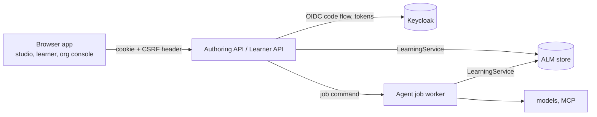

# Role applications: processes, modules and identity

This guide fixes the backend boundaries of the role applications described in the
[role-applications plan](../plans/role-applications-plan.md) and ordered by the
[prototype roadmap](../plans/prototype-roadmap.md). It applies owner defaults
D8–D10, approved with the roadmap (PR #73) and confirmed on 9 November 2026.

S03 builds the shared skeleton only: `services/api_common` and an Authoring API
with health and identity routes. No business endpoint exists yet; S05 adds the
first read-only modules. ALM remains the reference model. Nothing here changes
the ALM metamodel, the store schema or an AIM-PRO/jjodel export.

## Processes



| Process | Owns | Not allowed |
| --- | --- | --- |
| Authoring API (`services/authoring_api`) | staff sessions; projects, proposals, decisions, sources (from S05) | model credentials; direct store or decision internals |
| Learner API (S12) | learner sessions; requests, attempts, own progress with LEARNING redaction | any authoring module |
| Agent job worker (S08) | model calls, MCP retrieval, generators, orchestrator runs | serving browsers |

`LearningService` and its store own every write. An API process authorizes a
request against the trusted policy and calls the service; it never calls an
agent, a model, the database or MCP directly. A development profile may run
several processes in one Python process; the module boundaries stay the same.

## Agent jobs

Applications reach agents only through agent jobs (S08). A job is a typed command
that names exact input versions and a client `request_id`. The API authorizes it,
records it in the jobs store (D14: separate tables in a `jobs` schema, never the
ALM tables) and returns. The worker runs the existing service method. The result
is a pending proposal or a rejection with check codes; a person decides and
applies it through the decision endpoints. Job states: `QUEUED`, `RUNNING`,
`PROPOSED`, `REJECTED`, `FAILED`, `ABANDONED`. Progress events are the
content-free events of `agent_system/events.py`. The ALM `request_id` stays the
idempotency key: a replayed `request_id` returns the same job.

## Module rules

1. **One module, one router.** A module is an `ApiModule(name, router)` that
   declares its routes directly on its router. `ModuleRegistry` refuses duplicate
   names; `ALM_API_MODULES` selects modules by name (unset: all; empty: none).
   A module that is off has no routes.
2. **Reads and writes.** A read route depends on `current_principal`; a write
   route (`POST`, `PUT`, `PATCH`, `DELETE`) depends on `csrf_protected`.
   `create_app` refuses to build an app with a write route that lacks the CSRF
   check, and a module router that includes other routers (their routes could
   not be checked).
3. **No core internals.** Modules call `LearningService` and the read-only
   helpers it exposes. They never import `learning.store` or `learning.decisions`.
   When data is missing, a service method is added with tests first.
4. **Contracts.** Request and response models are Pydantic classes in the module,
   built from existing records; store rows are never exposed raw. The OpenAPI
   snapshot in `services/openapi/` is the contract:
   `python -m services.api_common.openapi --check` fails on drift and runs in CI;
   `python -m services.api_common.openapi` rewrites the snapshot for review. The
   snapshot contains every registered module, whatever a deployment selects.

## Errors and request ids

Every error has the body `{"error", "detail", "request_id"}`.

| Cause | Status | `error` | `detail` |
| --- | --- | --- | --- |
| no session, expired session, failed login | 401 | `unauthenticated` | fixed text |
| `AuthorizationError` from `learning.policies.authorize`, unmapped identity, CSRF | 403 | `forbidden` | fixed text |
| `StateConflict` (reload, then retry) | 409 | `conflict` | the conflict message |
| request model, record (`ValidationError`) or core `ValueError` | 422 | `validation` | locations and messages; never input values |
| identity provider unreachable or not the configured issuer | 502 | `identity_provider_unavailable` | fixed text |
| anything else | 500 | `internal` | `Internal error`; the exception is logged with the request id |

`AuthorizationError` subclasses `ValueError`, so existing callers that catch
`ValueError` keep working. Role checks that raise a plain `ValueError` (for
example "Project authoring requires content authority") are still 422.

The `X-Request-ID` header is accepted when it matches
`[A-Za-z0-9][A-Za-z0-9._:-]{0,127}`, otherwise replaced by a new id; it is echoed
on every response and available to handlers through `current_request_id()`.
This is the correlation id of the HTTP request, for logs, events and traces. It
is not the ALM `request_id` of a command, which the client sends in the body.

## Identity

### Backend-for-frontend (D8)

The API is a confidential OIDC client. The browser never holds a token.

1. `GET /auth/login?return_to=/path` creates `state`, `nonce` and a PKCE verifier,
   keeps them server-side for `ALM_API_LOGIN_TTL` seconds (600), sets the
   `alm_login` cookie (the state; `HttpOnly`, `SameSite=Lax`, path `/auth`) and
   redirects to the provider with `code_challenge_method=S256`.
2. `GET /auth/callback` requires the `alm_login` cookie to equal `state`, uses the
   pending login once, exchanges the code with the verifier and the client
   secret, and checks the ID token: RS256 signature from the provider JWKS,
   issuer, audience (and `azp` when there are several audiences), `exp`, `iat`
   and `nonce`. Any failure is 401 and creates no session.
3. The identity is mapped (D9). Unmapped: 403, no session. Mapped: a random
   session id in the `alm_session` cookie (`HttpOnly`, `SameSite=Lax`, `Secure`
   unless `ALM_API_COOKIE_SECURE=false`, path `/`), valid for
   `ALM_API_SESSION_TTL` seconds (3600); redirect 303 to `return_to` when it is a
   local path, otherwise to `/`.
4. `GET /auth/session` returns `subject_key`, `csrf_token` and `expires_at`
   (`Cache-Control: no-store`). Writes send the token in `X-CSRF-Token`.
5. `POST /auth/logout` (CSRF required) ends the session and returns the
   provider `end_session_url` (with `id_token_hint` and the post-logout
   redirect), which the app opens to end the provider session.

Sessions, tokens and pending logins live in process memory
(`MemorySessionStore`): a restart signs everyone out, and one API process serves
each user. Tokens are not refreshed; the session ends at its lifetime.

### Identity map (D9)

A host-side file (`ALM_IDENTITY_MAP`) maps exact (issuer, `sub`) pairs to policy
subject keys:

```json
{"format": 1, "identities": [
  {"issuer": "http://127.0.0.1:58080/realms/alm-dev",
   "subject": "218842f7-8cad-4b90-96d7-c0540c4bb7f7", "subject_key": "admin"}]}
```

The map grants nothing. Provider roles and groups are ignored; what a subject may
do is decided by the trusted policy, as for the CLI `--subject`. A pair listed
twice or an unknown field refuses the whole file. The issuer is compared
exactly, without URL normalization.

### Policy resolution (D10, from S05)

A configured directory holds trusted policy files. For each request the API
loads the file whose `policy_ref` equals the context's `policies` reference. No
match means the context is unavailable; installing an approved policy preview
stays a host operator action.

## Configuration

| Variable | Meaning |
| --- | --- |
| `ALM_OIDC_ISSUER` | exact issuer; discovery must report the same value |
| `ALM_OIDC_CLIENT_ID`, `ALM_OIDC_CLIENT_SECRET` | confidential client |
| `ALM_OIDC_REDIRECT_URI` | this API's `/auth/callback`, registered at the provider |
| `ALM_OIDC_POST_LOGOUT_REDIRECT_URI` | optional; registered at the provider |
| `ALM_IDENTITY_MAP` | path of the identity map |
| `ALM_API_COOKIE_SECURE` | `true` by default; `false` only for local HTTP |
| `ALM_API_SESSION_TTL`, `ALM_API_LOGIN_TTL` | seconds; defaults 3600 and 600 |
| `ALM_API_MODULES` | comma-separated module names; unset selects all |

## Local identity smoke test

`compose.identity.yml` runs Keycloak 26.8.1 (pinned by digest) with the realm
`alm-dev` from `infra/keycloak/alm-dev-realm.json`, imported at every start. The
realm has one confidential client, `alm-authoring-api` (code flow with S256 PKCE
only), and three synthetic users: `dev-admin` and `dev-learner`, mapped to the
subjects `admin` and `learner` of `tests/fixtures/alm/trusted-policy.json` by
`infra/keycloak/identity-map.dev.json`, and `dev-unmapped`. The realm file holds
placeholders; the client secret and the user password come from the environment.

```sh
export ALM_KEYCLOAK_ADMIN_PASSWORD=$(openssl rand -hex 16)
export ALM_KEYCLOAK_DEV_PASSWORD=$(openssl rand -hex 16)   # dev-* users
export ALM_OIDC_CLIENT_SECRET=$(openssl rand -hex 24)
docker compose -f compose.identity.yml up -d --wait

export ALM_OIDC_ISSUER=http://127.0.0.1:58080/realms/alm-dev
export ALM_OIDC_CLIENT_ID=alm-authoring-api
export ALM_OIDC_REDIRECT_URI=http://127.0.0.1:58000/auth/callback
export ALM_OIDC_POST_LOGOUT_REDIRECT_URI=http://127.0.0.1:58000/
export ALM_IDENTITY_MAP=infra/keycloak/identity-map.dev.json
export ALM_API_COOKIE_SECURE=false
python -m services.authoring_api          # http://127.0.0.1:58000
```

In a browser:

1. Open `http://127.0.0.1:58000/auth/login?return_to=/studio` and sign in as
   `dev-admin`. Expected: redirect to `/studio` (404 until S04 serves the studio).
2. Open `http://127.0.0.1:58000/auth/session`. Expected: `subject_key` `admin`,
   a `csrf_token`, an `expires_at` one hour ahead; no token in the body.
3. In the developer console, `fetch('/auth/logout', {method: 'POST'})` returns
   403; with `headers: {'X-CSRF-Token': '<csrf_token>'}` it returns
   `end_session_url`. Opening that URL ends the Keycloak session and returns to
   `http://127.0.0.1:58000/`. `/auth/session` is then 401.
4. Sign in as `dev-unmapped`. Expected: 403 `Identity is not mapped to a policy
   subject`, and `/auth/session` stays 401.

Stop with `docker compose -f compose.identity.yml down`. The issuer contains the
port 58080 and the client accepts only the redirect on port 58000; changing
either needs the realm file and the identity map changed with it.
