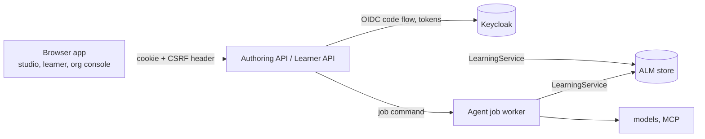

# Role applications: processes, modules and identity

This guide fixes the backend boundaries of the role applications described in the
[role-applications plan](../plans/role-applications-plan.md) and ordered by the
[prototype roadmap](../plans/prototype-roadmap.md). It applies owner defaults
D8–D10, approved with the roadmap (PR #73) and confirmed on 9 November 2026.

S03 builds the shared skeleton: `services/api_common` and an Authoring API
with health and identity routes. S05 adds the first read-only modules (see
[Read-only authoring endpoints](#read-only-authoring-endpoints-s05)); S06 adds
decisions and application (see [Review endpoints](#review-endpoints-s06)). S04 adds the front-end workspace in `apps/` and a studio
shell that signs in through the API (see [Front-end workspace](#front-end-workspace)). ALM remains the reference model. Nothing here changes
the ALM metamodel, the store schema or an AIM-PRO/jjodel export.

## Processes



| Process | Owns | Not allowed |
| --- | --- | --- |
| Authoring API (`services/authoring_api`) | staff sessions; projects, proposals, decisions, sources (from S05) | model credentials; direct store or decision internals |
| Learner API (S12) | learner sessions; requests, attempts, own progress with LEARNING redaction | any authoring module |
| Agent job worker (S08) | model calls, MCP retrieval, generators, orchestrator runs | serving browsers |

`LearningService` and its store own every write. An API process authorizes a
request against the trusted policy and calls the service; it never calls an
agent, a model, the database or MCP directly. A development profile may run
several processes in one Python process; the module boundaries stay the same.

## Agent jobs

Applications reach agents only through agent jobs (S08). A job is a typed command
that names exact input versions and a client `request_id`. The API authorizes it,
records it in the jobs store (D14: separate tables in a `jobs` schema, never the
ALM tables) and returns. The worker runs the existing service method. The result
is a pending proposal or a rejection with check codes; a person decides and
applies it through the decision endpoints. Job states: `QUEUED`, `RUNNING`,
`PROPOSED`, `REJECTED`, `FAILED`, `ABANDONED`. Progress events are the
content-free events of `agent_system/events.py`. The ALM `request_id` stays the
idempotency key: a replayed `request_id` returns the same job.

## Module rules

1. **One module, one router.** A module is an `ApiModule(name, router)` that
   declares its routes directly on its router. `ModuleRegistry` refuses duplicate
   names; `ALM_API_MODULES` selects modules by name (unset: all; empty: none).
   A module that is off has no routes.
2. **Reads and writes.** A read route depends on `current_principal`; a write
   route (`POST`, `PUT`, `PATCH`, `DELETE`) depends on `csrf_protected`.
   `create_app` refuses to build an app with a write route that lacks the CSRF
   check, and a module router that includes other routers (their routes could
   not be checked).
3. **No core internals.** Modules call `LearningService` and the read-only
   helpers it exposes. They never import `learning.store` or `learning.decisions`
   (checked by `ModuleBoundaryTest` in `tests/services/test_api_contexts.py`).
   When data is missing, a service method is added with tests first.
4. **Contracts.** Request and response models are Pydantic classes in the module,
   built from existing records; store rows are never exposed raw. The OpenAPI
   snapshot in `services/openapi/` is the contract:
   `python -m services.api_common.openapi --check` fails on drift and runs in CI;
   `python -m services.api_common.openapi` rewrites the snapshot for review. The
   snapshot contains every registered module, whatever a deployment selects.

## Errors and request ids

Every error has the body `{"error", "detail", "request_id"}`. The OpenAPI
snapshot documents that body (`ErrorBody`) for each error status of each route
(`error_responses` in `services/api_common/errors.py`), so the generated client
types error bodies correctly; FastAPI's default validation schema is not used.

| Cause | Status | `error` | `detail` |
| --- | --- | --- | --- |
| no session, expired session, failed login | 401 | `unauthenticated` | fixed text |
| `AuthorizationError` from `learning.policies.authorize`, unmapped identity, CSRF | 403 | `forbidden` | fixed text |
| `ContextUnavailable`: no such context, or its trusted policy is not installed (D10) | 404 | `context_unavailable` | `Context unavailable`; the reason is logged with the request id |
| `StateConflict` (reload, then retry) | 409 | `conflict` | the conflict message |
| request model, record (`ValidationError`) or core `ValueError` | 422 | `validation` | locations and messages; never input values |
| identity provider unreachable or not the configured issuer | 502 | `identity_provider_unavailable` | fixed text |
| anything else | 500 | `internal` | `Internal error`; the exception is logged with the request id |

`AuthorizationError` subclasses `ValueError`, so existing callers that catch
`ValueError` keep working. Role checks that raise a plain `ValueError` (for
example "Project authoring requires content authority") are still 422.

The `X-Request-ID` header is accepted when it matches
`[A-Za-z0-9][A-Za-z0-9._:-]{0,127}`, otherwise replaced by a new id; it is echoed
on every response and available to handlers through `current_request_id()`.
This is the correlation id of the HTTP request, for logs, events and traces. It
is not the ALM `request_id` of a command, which the client sends in the body.

## Identity

### Backend-for-frontend (D8)

The API is a confidential OIDC client. The browser never holds a token.

1. `GET /auth/login?return_to=/path` creates `state`, `nonce` and a PKCE verifier,
   keeps them server-side for `ALM_API_LOGIN_TTL` seconds (600), sets the
   `alm_login` cookie (the state; `HttpOnly`, `SameSite=Lax`, path `/auth`) and
   redirects to the provider with `code_challenge_method=S256`.
2. `GET /auth/callback` requires the `alm_login` cookie to equal `state`, uses the
   pending login once, exchanges the code with the verifier and the client
   secret, and checks the ID token: RS256 signature from the provider JWKS,
   issuer, audience (and `azp` when there are several audiences), `exp`, `iat`
   and `nonce`. Any failure is 401 and creates no session.
3. The identity is mapped (D9). Unmapped: 403, no session. Mapped: a random
   session id in the `alm_session` cookie (`HttpOnly`, `SameSite=Lax`, `Secure`
   unless `ALM_API_COOKIE_SECURE=false`, path `/`), valid for
   `ALM_API_SESSION_TTL` seconds (3600); redirect 303 to `return_to` when it is a
   local path, otherwise to `/`.
4. `GET /auth/session` returns `subject_key`, `csrf_token` and `expires_at`
   (`Cache-Control: no-store`). Writes send the token in `X-CSRF-Token`.
5. `POST /auth/logout` (CSRF required) ends the session and returns the
   provider `end_session_url` (with `id_token_hint` and the post-logout
   redirect), which the app opens to end the provider session.

Sessions, tokens and pending logins live in process memory
(`MemorySessionStore`): a restart signs everyone out, and one API process serves
each user. Tokens are not refreshed; the session ends at its lifetime.

### Identity map (D9)

A host-side file (`ALM_IDENTITY_MAP`) maps exact (issuer, `sub`) pairs to policy
subject keys:

```json
{"format": 1, "identities": [
  {"issuer": "http://127.0.0.1:58080/realms/alm-dev",
   "subject": "218842f7-8cad-4b90-96d7-c0540c4bb7f7", "subject_key": "admin"}]}
```

The map grants nothing. Provider roles and groups are ignored; what a subject may
do is decided by the trusted policy, as for the CLI `--subject`. A pair listed
twice or an unknown field refuses the whole file. The issuer is compared
exactly, without URL normalization.

### Policy resolution (D10, from S05)

A configured directory (`ALM_POLICY_DIR`) holds trusted policy files. For each
request the API reads the context's `policies` reference and loads the
`*.json` file whose `policy_ref` equals it exactly (`PolicyDirectory` in
`services/api_common/contexts.py`). No match means the context is unavailable
(404 `context_unavailable`); a context that does not exist gives the same
answer, so a response does not reveal which contexts exist. The directory is
read on every request: installing an approved policy preview stays a host
operator action, a file copy, and needs no restart. A file that is not a valid
trusted policy, or a `policy_ref` found in two files, refuses every resolution
(500, logged with the file name) instead of choosing one. Subdirectories and
other files are ignored.

## Configuration

| Variable | Meaning |
| --- | --- |
| `ALM_OIDC_ISSUER` | exact issuer; discovery must report the same value |
| `ALM_OIDC_CLIENT_ID`, `ALM_OIDC_CLIENT_SECRET` | confidential client |
| `ALM_OIDC_REDIRECT_URI` | this API's `/auth/callback`, registered at the provider |
| `ALM_OIDC_POST_LOGOUT_REDIRECT_URI` | optional; registered at the provider |
| `ALM_IDENTITY_MAP` | path of the identity map |
| `ALM_API_COOKIE_SECURE` | `true` by default; `false` only for local HTTP |
| `ALM_API_SESSION_TTL`, `ALM_API_LOGIN_TTL` | seconds; defaults 3600 and 600 |
| `ALM_API_MODULES` | comma-separated module names; unset selects all |
| `ALM_STORE` | ALM store: an existing SQLite file or a `postgresql://` URL (kept secret: it may hold a password); required when any authoring module is selected |
| `ALM_POLICY_DIR` | directory of trusted policy files (D10); required with `ALM_STORE` |

`ALM_API_MODULES=` (empty) runs the identity routes alone, without a store. The
API never creates a SQLite database: a missing file refuses to start.

## Read-only authoring endpoints (S05)

Four modules, each one router, all reads (`GET`, a session, no CSRF). Each
response is a record the CLI already prints, so every endpoint has a parity
test with its CLI command on the same seeded database
(`tests/services/test_authoring_read_api.py`). Responses carry
`Cache-Control: no-store`.

| Module | Route | Response | CLI equivalent |
| --- | --- | --- | --- |
| `contexts` | `GET /contexts/{context_id}` | `ContextSummary`: context, visible entities, findings | `show` |
| `review` | `GET /contexts/{context_id}/pending-proposals` | `PendingProposals`: newest first, each with the proposal, its exact candidates and `review_payload_key` | `show` (proposals `AWAITING_DECISION`) and the preview `decide` prints before `CONFIRM` |
| `projects` | `GET /contexts/{context_id}/projects/{project_id}` | `ProjectInspection` | `show-authoring-project` |
| `projects` | `GET /contexts/{context_id}/resources/{resource_id}/versions/{version}/project-syllabus` | `ApprovedSyllabus` of that exact current project revision | `show-project-syllabus` |
| `releases` | `GET /contexts/{context_id}/resources/{resource_id}/versions/{version}/release` | `ReleaseInspection` | `show-release` |

- **One store and policy per request.** `ContextServices.open` opens the store,
  resolves the policy (D10) and builds a `LearningService` with it inside the
  route function, then closes the store. The service's orchestrator factory
  refuses: the API never builds agents.
- **Redaction.** A learner-only subject gets exactly what `show` gives it: the
  context, its own participant record and its own learning records; its pending
  proposal list is empty. Project and release reads need the `propose` action
  and content authority, as in the CLI.
- **No writes.** The table digests of the store (row count and SHA-256 per
  table, as the copy tool computes them) are unchanged after every endpoint,
  for every subject, including refusals.
- **Review key.** `review_payload_key` is `learning.decisions.review_payload_key`
  over the proposal and its candidates, the key `decide` records. A decision
  sends it back (S06).
- Exact references in paths: `resource_id` and `version` name one `Resource`;
  identifiers with `:` are sent percent-encoded.

## Review endpoints (S06)

Two writes in the `review` module. Both need a session and the CSRF token
(`X-CSRF-Token`, D8) through `context_writer`, resolve the context as the reads
do (404 `context_unavailable`), answer `Cache-Control: no-store` and return the
entity the CLI prints.

| Route | Body | Response | CLI equivalent |
| --- | --- | --- | --- |
| `POST /contexts/{context_id}/decisions` | `DecisionRequest`: `target` (exact `EntityRef`), `decision` (`APPROVE`, `REJECT`, `REQUEST_REVISION`), `reason`, `review_payload_key` | the `HumanDecision` | `decide` after `CONFIRM` |
| `POST /contexts/{context_id}/applications` | `ApplicationRequest`: `proposal` (`EntityRef`), `operation_id` | the `StateChange` | `apply --operation-id` |

- **Stale review → 409.** `LearningService.decide(..., expected_key=...)` refuses
  with `StateConflict` when the key differs from the key of `target`, or when
  `target` is no longer the latest revision of that record (for example another
  reviewer decided after the inbox was loaded). The key ignores `status` and
  `decision`, so a decision alone never changes it; the revision check is what
  catches a concurrent decision. The client reloads and reviews again; a
  decision on the reloaded revision is allowed (a revocation, as in the CLI).
  Nothing is written before the check.
- **One write transaction.** `decide` now runs the context load, the checks and
  the writes in one write transaction, for the CLI too, so the payload that was
  checked is the payload that is decided. Without `expected_key` (the CLI) the
  rules are unchanged: a decision on an earlier revision is still recorded.
- **Replay.** `apply` is the core `apply_proposal`: the same `operation_id`
  returns the stored `StateChange` without writing; the same id for another
  proposal is 409. A proposal that is not approved is 422, as the CLI exits 2.
- **Authority unchanged.** The core checks the `decide` and `apply` actions
  (403) and the reviewer roles: administrative authority for `Participant` and
  `PolicySet`, assessment authority for `Evaluation`, content authority for the
  other kinds (422, plain `ValueError`).
- **Interchangeable with the CLI.** A decision recorded by one is applied by the
  other, and an application replays across both with the same operation id
  (`tests/services/test_authoring_review_api.py`, on SQLite and PostgreSQL).

## Synthetic seed (D15)

`python -m tests.seed --output DIR [--db LOCATION]` builds a development
database through the production commands; only model and retrieval responses are
synthetic (the fixtures of `tests/authoring_cycle_fixtures.py`). No model or
network is used. `DIR` must be new or empty and receives `alm.sqlite` (unless
`--db`; a PostgreSQL URL is never written to disk), `policies/` (the installed
trusted policy), `policy-previews/` (the delivery import's preview, not
installed) and `seed.json` (contexts, subjects, exact references).

| Context | State |
| --- | --- |
| `architecture-authoring` | applied syllabus, project, assessment, teacher and trainer content, completion rules and release; one pending Evaluator revision |
| `architecture-delivery` | the applied import of that release; its policy is the preview, so it is unavailable until the preview is copied into `policies/` |
| `architecture-delivery-2` | a pending import of the same release; `learner` is a participant |

The subjects are `admin` (administrator, content responsible, assessor) and
`learner`, the subject keys of the dev identity map.

## Front-end workspace

`apps/` is an npm workspace (D12) with exact versions in `apps/package-lock.json`;
Node 22.22 or later.

| Workspace | Content |
| --- | --- |
| `packages/api-client` | `src/generated/authoring.ts`, generated by `openapi-typescript` from `services/openapi/authoring.json`; `createAuthoringClient` (`openapi-fetch`, same-origin credentials, `no-store`). Front-end modules reach the API only through it |
| `packages/ui` | design tokens (`tokens.css`), base styles, `AppShell` (skip link, banner, main), `Button`, `StatusMessage`. Components carry no text of their own; colour pairs are tested against WCAG 2.1 AA contrast |
| `packages/auth` | `createSessionApi` (`/auth/session`, `/auth/logout` with `X-CSRF-Token`), `loginUrl`, `SessionProvider` and `useSession`. The CSRF token stays in memory; nothing is written to browser storage |
| `studio` | React shell served under `/studio/`: sign-in, signed-in subject, sign-out, not-found page. Routes in `src/routes.tsx`, one folder per feature in `src/features/` |

Commands, run in `apps/`:

| Command | Effect |
| --- | --- |
| `npm ci --ignore-scripts` | install from the lockfile |
| `npm run generate:client` | rewrite the generated client after the snapshot changes |
| `npm run check:client` | exit 1 when the client differs from the snapshot (CI) |
| `npm run typecheck`, `npm test`, `npm run build` | TypeScript, Vitest (all workspaces), studio build in `studio/dist` |

The CI job `front-end` runs the last four. An API change is therefore two steps:
`python -m services.api_common.openapi` rewrites the snapshot, then
`npm run generate:client` rewrites the client; both are reviewed in the PR.

**Strings.** Every visible string is in a JSON catalogue (`studio/src/i18n/en.json`)
read through `i18next`; translation keys are type-checked against it. The test
`apps/tests/user-visible-strings.test.ts` fails when a component under
`packages/*/src` or `studio/src` contains JSX text with a letter, a string
literal as a JSX child, or a literal `aria-label`, `title`, `alt`, `placeholder`
or `label`. A new language is one more catalogue.

**Serving.** The dev realm registers the callback and the post-logout page on
`127.0.0.1:58000`. In development the studio's Vite server (`npm run dev`, or
`npm run preview` for the build) listens there and forwards `/auth`,
`/health` and `/contexts` to the API on `ALM_STUDIO_API_URL` (default `http://127.0.0.1:58001`),
so the browser sees one origin and the session cookie stays same-site. `/`
redirects to `/studio/`. How a shared deployment serves the built studio (API
or reverse proxy) is part of D17.

## Local identity smoke test

`compose.identity.yml` runs Keycloak 26.8.1 (pinned by digest) with the realm
`alm-dev` from `infra/keycloak/alm-dev-realm.json`, imported at every start. The
realm has one confidential client, `alm-authoring-api` (code flow with S256 PKCE
only), and three synthetic users: `dev-admin` and `dev-learner`, mapped to the
subjects `admin` and `learner` of `tests/fixtures/alm/trusted-policy.json` by
`infra/keycloak/identity-map.dev.json`, and `dev-unmapped`. The realm file holds
placeholders; the client secret and the user password come from the environment.

```sh
export ALM_KEYCLOAK_ADMIN_PASSWORD=$(openssl rand -hex 16)
export ALM_KEYCLOAK_DEV_PASSWORD=$(openssl rand -hex 16)   # dev-* users
export ALM_OIDC_CLIENT_SECRET=$(openssl rand -hex 24)
docker compose -f compose.identity.yml up -d --wait

export ALM_OIDC_ISSUER=http://127.0.0.1:58080/realms/alm-dev
export ALM_OIDC_CLIENT_ID=alm-authoring-api
export ALM_OIDC_REDIRECT_URI=http://127.0.0.1:58000/auth/callback
export ALM_OIDC_POST_LOGOUT_REDIRECT_URI=http://127.0.0.1:58000/
export ALM_IDENTITY_MAP=infra/keycloak/identity-map.dev.json
export ALM_API_COOKIE_SECURE=false
python -m tests.seed --output /tmp/alm-seed     # any new directory
export ALM_STORE=/tmp/alm-seed/alm.sqlite ALM_POLICY_DIR=/tmp/alm-seed/policies
python -m services.authoring_api          # http://127.0.0.1:58000
```

In a browser:

1. Open `http://127.0.0.1:58000/auth/login?return_to=/studio` and sign in as
   `dev-admin`. Expected: redirect to `/studio` (404 here: the API alone does not
   serve the studio; see "With the studio" below).
2. Open `http://127.0.0.1:58000/auth/session`. Expected: `subject_key` `admin`,
   a `csrf_token`, an `expires_at` one hour ahead; no token in the body.
3. In the developer console, `fetch('/auth/logout', {method: 'POST'})` returns
   403; with `headers: {'X-CSRF-Token': '<csrf_token>'}` it returns
   `end_session_url`. Opening that URL ends the Keycloak session and returns to
   `http://127.0.0.1:58000/`. `/auth/session` is then 401.
4. Sign in as `dev-unmapped`. Expected: 403 `Identity is not mapped to a policy
   subject`, and `/auth/session` stays 401.
5. Signed in as `dev-admin`, open `/contexts/architecture-authoring/pending-proposals`.
   Expected: one proposal with its candidates and `review_payload_key`.
   `/contexts/architecture-delivery` is 404 `context_unavailable` until the
   preview file is copied into `ALM_POLICY_DIR`. As `dev-learner`,
   `/contexts/architecture-delivery-2` lists only the context and the learner's
   own participant record.

### With the studio

Same Keycloak and variables, but the API moves to port 58001 and the studio takes
58000:

```sh
python -m services.authoring_api --port 58001
cd apps && npm ci --ignore-scripts && npm run dev --workspace @alm/studio   # http://127.0.0.1:58000/studio/
```

1. Open `http://127.0.0.1:58000/studio/`. Expected: "Sign in to the studio"; the
   first Tab focuses "Skip to main content".
2. Press "Sign in" and sign in as `dev-admin`. Expected: back on `/studio/`, the
   banner shows "Signed in as admin" and "Sign out"; `document.cookie`,
   `localStorage` and `sessionStorage` are empty (the session cookie is `HttpOnly`).
3. Press "Sign out". Expected: the provider session ends and the browser returns
   to `/studio/` with "Sign in to the studio"; signing in again asks for the
   password.
4. Sign in as `dev-unmapped`. Expected: the callback answers 403 `Identity is not
   mapped to a policy subject`; `/studio/` still offers sign-in.

Stop with `docker compose -f compose.identity.yml down`. The issuer contains the
port 58080 and the client accepts only the redirect on port 58000; changing
either needs the realm file and the identity map changed with it.
