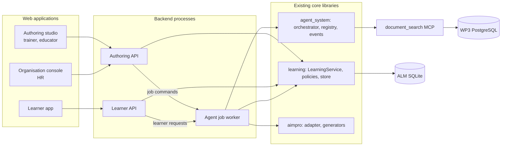

# Role applications over the agentic network — modular plan

Prepared on 5 November 2026 from the [pipeline coverage map](https://claude.ai/artifact/THjWCfqMQjhm9m2jpVM41d),
the nine screens of partner mock-up A and the current `main` branch. This is a
plan, not evidence that any step is implemented or approved.

**Direction update (8 November 2026).** The owner set ALM as the reference model
for the prototype. SCN01 will change and further scenarios will follow; the
AIM-PRO metamodel will be revised. Mappings to AIM-PRO may come later and do not
block any phase. The goal is a working prototype for each role. The execution order,
step scope and chat protocol are in the [prototype roadmap](prototype-roadmap.md),
which wins where the two differ. Production
release, delivery import and activation commands now exist (R1, #71, PR #72).

## Goal

Give each human role a web application that works through the existing agentic
network: HR, trainers, educators and learners. Each phase delivers a separate,
testable module rather than one monolithic application. The ALM service stays the only
state authority. Applications never call agents, models, SQLite or MCP directly.

## Constraints carried from current decisions

- **State authority.** `LearningService` and the SQLite store own every write.
  Proposals, decisions and applications keep their current exact-payload checks.
- **Review rule (decision 5).** Every generated artefact remains a proposal that
  needs review and human approval. Mock-up A's ungated activities generator is
  not reproduced.
- **Review surface (register §4).** Owner direction is a web app over the ALM
  service, with pilot approval later. The CLI stays available.
- **Orchestration (#15).** CrewAI Flow is current, LangGraph is under comparison.
  Applications must not depend on either.
- **Dashboards and twins (#17, #19).** Monitoring views wait for the twin design
  and the MontiGem/jjodel evaluation. This plan does not choose that technology.
- **Learner data (decision 3, #28).** Self-reports, diagnostics, checkpoint
  results and monitoring are deferred until the legal discussion with partners.
- **Reference model.** ALM is the reference. AIM-PRO and jjodel exports are not
  edited; mappings to AIM-PRO are later work and block no phase. Fixtures stay
  scenario-neutral rather than tied to SCN01.
- **Live runs.** Any test that calls a model provider needs owner authorization.

## Architecture



### Why these process boundaries

The backend is split only where the boundary protects something real. Splitting
the single ALM state authority into many services would break its transactional
checks.

| Process | Owns | Reason for a separate process |
| --- | --- | --- |
| Authoring API | Projects, proposals, decisions, sources, organisation data | Staff-only permissions; content kept for review |
| Learner API | Learner requests, attempts, own progress | LEARNING-mode redaction and a smaller attack surface; no authoring code reachable from learner sessions |
| Agent job worker | Model calls, MCP retrieval, generators, orchestrator runs | Only process holding model credentials; runs that take minutes stay out of HTTP requests; orchestrator can change (#15) without touching APIs |
| Existing services | MCP search, WP3 PostgreSQL, Langfuse | Already separate |

All three new processes import the same core libraries. A local development
profile may run them in one Python process, but module boundaries stay the same.

### The interface to the agentic network

Applications reach agents only through **agent jobs**. An agent job is a typed
command that names exact input versions, together with the job's status.

1. The application sends a command, such as `generate-project-assessments` with
   project and syllabus versions and a client `request_id`.
2. The API authorizes it with the trusted policy and stores a job record. No model
   is called during the HTTP request.
3. The worker runs the existing service method. Today these are
   `generate_project_assessments`, `generate_project_teacher`,
   `generate_project_trainer`, `generate_aimpro_syllabus`,
   `prepare_aimpro_syllabus_sources` and `request`.
4. The result is a pending proposal in the ALM store, or a rejection with its check codes.
5. The application shows the proposal in the review inbox. A person decides, then
   applies it, through the existing decision API.

| Job status | Meaning |
| --- | --- |
| `QUEUED` | Authorized and waiting for the worker |
| `RUNNING` | Worker started; progress events stream to the client |
| `PROPOSED` | A pending proposal exists; the job links to it |
| `REJECTED` | Host checks or Lead review rejected the output; codes shown |
| `FAILED` | Infrastructure or provider error; no proposal |
| `ABANDONED` | Abandoned by an authorized administrator; uses the existing `abandon` command |

Progress uses the content-free events from `agent_system/events.py`. The worker
forwards them through a new in-memory sink, and the API streams them with
server-sent events. Prompt, document and learner text never reach that stream.
Job records live in a separate jobs store, not in the ALM database, so the ALM
schema does not change. The ALM `request_id` stays the idempotency key.

### Contract-first boundary

- **API contracts.** Request and response models are Pydantic classes in each
  API module, built from existing records (`ProjectInspection`,
  `GenerationCommand`, proposal views). Inner store entities are not exposed raw.
- **OpenAPI snapshot.** The snapshot is checked into the repository. A `--check`
  command fails when it drifts, like `python -m aimpro.generate --check`.
- **TypeScript client.** Generated from the snapshot. Front-end modules use only
  that client.
- **Approval binding.** Every decision request carries the reviewed payload key
  from `learning.decisions.review_payload_key`. A stale screen cannot approve a
  changed payload.
- **Concurrency.** Store conflicts (`StateConflict`) map to HTTP 409, and the
  application reloads before retrying.

## Repository layout

```text
learning/  aimpro/  agent_system/  document_search/   # existing core, unchanged ownership
services/
  api_common/        # identity adapter, error mapping, OpenAPI helpers, module registry
  authoring_api/     # modules: review, projects, jobs, sources, organisation, discovery
  learner_api/       # modules: practice, progress
  jobs/              # job store, worker loop, event sink, job kinds registry
apps/
  packages/
    api-client/      # generated from the OpenAPI snapshots
    ui/              # shared components and design tokens
    auth/            # session handling shared by all apps
  studio/            # trainer and educator: review inbox, projects, generation, sources
  learner/           # learner practice and own progress
  org-console/       # HR: organisation context, guidance, competence discovery (later)
tests/services/      # contract and module tests with synthetic fixtures
```

### Module rules

1. **Backend modules.** Each module is one package with its routes, schemas and
   tests. It registers itself in the `api_common` module registry, so a
   deployment selects modules by configuration. This follows the same pattern
   as `AgentRegistry` and `TaskDispatcher`.
2. **No access to core internals.** Modules call `LearningService` and the
   read-only helpers it exposes. They never import `learning.store` or
   `learning.decisions` directly. When a module needs data that is not
   available, add a service method with tests first.
3. **Front-end features.** Each feature is a folder with its routes, API hooks and
   components. Features do not share mutable state; they meet only through the API.
4. **One app per audience.** A learner build contains no authoring code, and an
   HR build contains no learner runtime.
5. **Toggling a module.** Turning a module off removes its routes and its
   navigation entry. Nothing else changes.

## Module map

| Module | App | Mock-up A screen | Coverage-map row | Existing core | Status today |
| --- | --- | --- | --- | --- | --- |
| Identity and policy | all | — | Start a path | `TrustedPolicy`, `authorize` | No authentication; CLI trusts `--subject` |
| Review inbox | studio | all gates | Human approval surface | `show`, `decide`, `apply`, `inspect_authoring_project` | CLI only |
| Authoring projects | studio | Learning path designer | Path skeleton | `projects.py`, Curator syllabus | Service and CLI |
| Agent jobs | studio, learner | all generators | all generation rows | generators, orchestrator | CLI, runs in process |
| Sources and licences | studio | Learning activities generator (resource selection) | Resource discovery and selection | MCP, `prepare_aimpro_syllabus_sources`, bindings | Service and CLI |
| Design conversation | studio | Design Agent | Goals and topics | requirements analyst | Partial; no conversation |
| Scaffolding library | studio | Scaffolding agents | Scaffolding | Trainer generator, Socratic worker | Partial; no rule triggers |
| Learner practice | learner | Output evaluation exercise trainer | Guided practice | `request`, `submit`, assessment | Service and CLI |
| Learner progress | learner | Output evaluation path manager | Learner monitoring (own view) | learning states, occurrences | Data only |
| Organisation context | org-console | Contextualising agent | Organisational contextualisation | none | Gap |
| Guidance documents | org-console | Organizational vision & guidance | Organisational guidance documents | none | Gap |
| Competence discovery | org-console | AI Literacy Assessor | Competence discovery | Evaluator, approval flow | Gap |
| Monitoring dashboard | org-console | Scaffolding checkpoint results | Learner monitoring and alerts | event log, traces | Gap; waits for #17, #19 |
| Release and delivery | studio | — | Release and delivery | `releases.py` (R1) | Service and CLI; activation refused while ASSESS has no runtime role (D4) |

## Phases

Each phase is one or more pull requests. Each ends with a handoff in
`docs/plans/handoffs/`, as in the [sequential chat plan](sequential-chat-plan.md).
All automated tests use synthetic fixtures. Live model checks run only with owner
authorization.

### Phase 0 — Decisions and skeleton

The owner decided on 8 November 2026 (see "Decisions" below): FastAPI with
React/TypeScript/Vite, Keycloak OIDC from the start, PostgreSQL for the ALM store
now, English UI with externalised strings. Phase 0 is therefore split:

- **0a — Store transaction API.** Move every direct `store.db` use (about 90 call
  sites in `learning` and `aimpro`, including `BEGIN IMMEDIATE` and raw `requests`
  SQL) behind `LearningStore` methods: a write transaction, a read transaction and
  request reservation. SQLite stays the only backend; no behaviour change; all
  suites stay green.
- **0b — PostgreSQL backend.** A second `LearningStore` backend with the same
  logical tables (entities, contexts, operations, requests) and the same
  guarantees: serialized writes per transaction (an advisory transaction lock in
  place of `BEGIN IMMEDIATE`), immutable versions, request replay. The store
  suite runs against both backends; PostgreSQL tests are opt-in locally and run
  with a service container in CI. A one-way copy tool from SQLite files.
- **0c — Skeleton and identity.** `docs/architecture/role-applications.md`;
  `services/api_common` with the module registry, error mapping, OpenAPI snapshot
  check and an OIDC adapter (local Keycloak in a compose file, realm export
  checked in, roles mapped to policy subject keys); `apps/` with the shared
  packages, externalised strings and an empty studio shell with login.
- **Exit:** CI builds both halves, `--check` passes, both store backends pass the
  same store suite, and login against local Keycloak reaches the empty studio.

### Phase 1 — Read-only Authoring API

- **Endpoints:**
  - context summary (equivalent to `show`);
  - pending proposals with their exact payload and review key;
  - project inspection, with receipts and stale dependencies;
  - approved syllabus.
- **Identity:** the Keycloak OIDC adapter from phase 0c maps the authenticated
  user to a `subject_key`; the trusted policy remains the only authority.
- **Tests:** for each endpoint, a parity check that it returns the same
  references as the CLI on the same synthetic database.
- **Exit:** the studio lists contexts, proposals and projects without any write.

### Phase 2 — Review inbox (first usable app)

- **Endpoints:** decide and apply, carrying the review key and the operation id.
- **Studio views:**
  - a pending queue;
  - a payload viewer with source excerpts and diagnostics;
  - a version diff against the previous applied artefact;
  - separate approve and apply steps.
- **Covers:** the gates that already exist in the prototype (path skeleton,
  resource bindings, generated content). This answers register §4.
- **Exit:**
  - a reviewer completes an Evaluator approval path on a synthetic database;
  - a stale payload is refused;
  - CLI and web decisions are interchangeable.
- **Then:** teacher validation of the review flow, as the register asks before
  a pilot.

### Phase 3 — Agent job worker

- **Build:**
  - `services/jobs` with the job store and worker loop;
  - a job-kind registry, one entry per existing generator;
  - an event sink and a server-sent-events endpoint;
  - mapping of the abandon command.
- **Credentials:** model credentials and the MCP client configuration are
  loaded only by the worker.
- **Tests:**
  - jobs run against a fake dispatcher, the way the current generator tests do;
  - a replayed `request_id` returns the same job;
  - an interrupted job can be abandoned;
  - no event carries content (the strict event log in tests).
- **Exit:** a Curator or Evaluator job started from the studio ends as a pending
  proposal in the inbox.

### Phase 4 — Authoring studio

- **Projects:** initialize and revise projects; select artefact versions.
- **Generation:** forms for the Curator, Evaluator, Teacher and Trainer jobs.
  Each form shows the exact inputs it will send.
- **Sources:** source preparation, with licence verdicts shown as usage
  conditions (OPEN, OPEN_NC, SHARE_ALIKE). Resource binding proposals.
- **Focused regeneration** of one unit, as named in register §4.
- **Out of scope:** the Design Agent conversation. It needs a new conversational
  job kind, which is a separate increment after this phase.
- **Exit:** the synthetic authoring cycle runs from the studio with synthetic
  responses, reaching the same state as the existing acceptance test.

### Phase 5 — Learner API and learner app

- **Process:** a separate Learner API with LEARNING redaction on.
- **Endpoints:** learner request (`request`) as a job, attempt submission
  (`submit`), and the learner's own progress (occurrences and approved learning
  states only).
- **Learner app:** the practice screen with the Socratic coach, and a progress
  view. Choosing between alternative next exercises waits for decision 1.
- **Exit:**
  - a learner can reach only their own data;
  - the trainer evaluation stays proposed and approved separately;
  - the adversarial suite (`python -m evaluation --check`) still passes.

### Phase 6 — Organisation context and guidance (needs decision 6 details)

- **Build:** upload of author-supplied and company documents as versioned
  Resources, cited like WP3 excerpts and treated as untrusted planning input,
  with injection tests.
- **New job kinds:**
  - contextualisation of an approved activity: a proposal that keeps the
    learning objective and uses fictional data;
  - guidance-document drafting: a proposal whose regulatory references are
    flagged for organisational review.
- **Exit:** both outputs pass through the review inbox. Nothing reaches learners
  without approval.

### Phase 7 — Competence discovery and monitoring (blocked)

- **Blocked by:** decision 3, the learner-model attributes from WP4/WP2 (#28)
  and the twin design (#17, #19).
- **Prepare in the meantime:** the job contract for a diagnostic survey generated
  by the Evaluator, and an approval gate that turns validated gaps into project
  goals. Neither collects learner data.
- **Exit:** set when the decisions are made.

### Phase 8 — Release and delivery

- **No longer blocked by AIM-PRO convergence** (direction update above). The
  commands exist (`docs/architecture/releases.md`).
- **Build:** studio views for `propose-release`, `show-release`,
  `propose-delivery-import` and `propose-activation`, with the policy preview
  shown for review. Activation of designs with ASSESS activities stays refused
  until the runtime assessor role (G7) and a decision lifting D4.
- **Exit:** the synthetic cycle reaches an activated delivery from the studio.

## Cross-cutting requirements

- **Security**
  - Server-side sessions; CSRF protection on writes.
  - No credentials in browser builds.
  - The trusted policy file stays on the host.
  - The identity adapter maps authenticated users to subject keys. The policy
    grants remain the only authority.
- **Privacy**
  - Pseudonymous subject keys in traces, as Langfuse does today.
  - LEARNING redaction in the Learner API.
  - Retention follows the 30-day intent until #28 decides otherwise.
- **Observability.** Every API request and job carries the request id that
  already links event-log entries and Langfuse traces.
- **Testing**
  - Contract tests per module.
  - Browser end-to-end tests on synthetic databases.
  - The existing unit and evaluation suites must stay green on every PR.
- **Accessibility and language.** Shared UI components meet WCAG 2.1 AA. UI text
  is externalised so partners can add languages.

## Decisions

Decided by the owner on 8 November 2026: API framework FastAPI; front-end React
with TypeScript and Vite; identity Keycloak OIDC from the start (instead of a
development adapter first); ALM store on PostgreSQL now; UI English first with
externalised strings. The deployment owner is still open. The original
recommendations follow for reference.

| Topic | Recommendation | Why |
| --- | --- | --- |
| API framework | FastAPI | Pydantic-native, matches every existing contract, generates OpenAPI |
| Front-end stack | React with TypeScript and Vite, one app per audience | Typed client from OpenAPI; independent builds; does not pre-empt #19 for dashboards |
| Identity | OIDC against a local Keycloak for development; partner identity provider for the pilot | Standard claims map cleanly to subject keys and roles |
| Store concurrency | Keep SQLite for single-host development; decide on PostgreSQL before multi-user pilots | Several processes writing one SQLite file serialize writes; optimistic checks exist but throughput is limited |
| Deployment owner | To assign through rik99 | Needed before any shared environment |
| UI languages | English first, externalised strings | Partners may need local languages |

## Out of scope

- Dashboards for twins or cohort analytics before #17 and #19.
- Any change to the AIM-PRO metamodel, jjodel exports or ALM schema.
- Mock-up A's ungated activity generation.
- Learner-initiated paths (decision 2).
